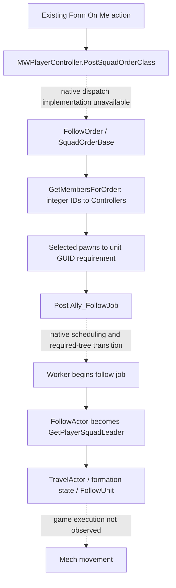

# From source mapping to live tactical decisions

Date: 2026-09-20 local / 2026-09-21 UTC. **PROPOSED next implementation scope, grounded in OBSERVED source and DOCUMENTED declarations.** No runtime, mod, live telemetry reader or game controller was created or executed. This is the synthesis of [AI assignment](../research/AI_ASSIGNMENT_TRACE.md), [order lifecycle](../research/ORDER_LIFECYCLE_TRACE.md) and [tactical observations](../research/TACTICAL_STATE_TRACE.md), all using the [verified editor collection](../research/AI_COLLECTION_RESULT_2026-09-20.md).

## What the research now supports

The nearer goal is a tactical layer directing current AI lancemates during missions. The eventual user goal remains human-like real-time play. The first useful integration is one current AI, one fresh observation and one verified native Form On Me order. This establishes the control path before adding autonomous choices or all-three coordination.

The collected source identifies a usable *candidate* order/job route and concrete readback APIs. It does not demonstrate a working external connection, native scheduling/authority, current actor identity or human precedence. Those are the next proof obligations, not missing personality or voice work.

Solid edges represent connected source. Dashed edges mark missing native implementation or unperformed runtime evidence. The resolver itself is native; the diagram does not claim its internal selection rules. General and ally master trees share combat subtrees, so globally changing combat logic must not be presumed to affect only lancemates.

## Decisions established by the trace

| Decision | Evidence and practical consequence |
|---|---|
| Preserve existing low-level combat for the first milestone | Connected tactic selection already chooses Ranged, Indirect, Tank, Mobile and HitAndRun according to primary-role feasibility, weight and weapon-range capability. These rules are now mapped; no improvement in play has been measured. |
| Begin with native Form On Me | UI posts FollowOrder with Medium priority and false bPersistent. FollowJob writes movement/formation state, but it follows the current player-squad leader during worker setup. It is not a demonstrated arbitrary-actor follow command. |
| Bind a current AI actor, not a UI slot | Native IDs are distinct from display indexes and are documented server-only. The generic order route returns Controller objects and does not itself establish AI-only eligibility. Mech swapping changes controller/pawn assignments. |
| Observe assignment separately from movement | UI OnComplete has no acceptance result. A worker bound to the correct pawn with a running Follow job and expected target is stronger evidence; independent motion observation is still required. |
| Do not infer manual origin from bPlayerIssued | A companion using the player route may share that classification. The job-change event alone cannot distinguish physical input from the companion's own submission. |
| Treat toggle actions separately | Hold-fire and ECM paths do not use the same job posting flow. They are toggles/cycles, not verified idempotent desired-state setters. They stay outside the first action allowlist. |

Source locations and qualifications are in the three trace reports. In particular, the order graph removes a worker from an existing player-issued job before posting the replacement, and discards the returned posting ID. Repeated blind resubmission is therefore not a suitable acknowledgement strategy.

## Minimal observation contract to implement next

These are **project-defined groups**, not an existing MW5 telemetry protocol. The next artifact should be a concrete passive-probe design and implementation manifest. Acquiring an editor declaration is not collecting a live sample.

| Required observation | Actual source/API candidates | Unresolved validation |
|---|---|---|
| Current world and allowed mission phase | `MWBlueprintUtils.get_current_area`; `MWArea.is_loading/is_initialized/is_mission_hub`; `GameplayStatics.is_game_paused`; MWGameState menu/cutscene state | Valid world acquisition, transitions/teardown and an authoritative single-player mission predicate |
| Exact player squad and current recipient | `MWPlayerController.squad`, `MWSquad.get_ai_members`, display info for a Controller, server-only squad_member_id, `get_members_for_order` | A fresh server-side ID must resolve to exactly one intended current AI Controller; no UI-slot assumption |
| Current AI pawn and worker | `Controller.get_controlled_pawn`, `Pawn.get_controller/is_player_controlled`, `MWMech.is_configured`, living-actor `is_dead`, worker `get_actor` | Reciprocal identity, valid AI membership, alive/configured state, worker-to-pawn equality and destruction/possession invalidation |
| Intended issuer and actual follow leader | Current issuer pawn plus `MWBlueprintUtils.get_player_squad_leader` | Leader selection after a mech swap/co-op transition; reject mismatches with intended follow semantics |
| Native order state and motion | Worker `get_job`; job type/state/posting/workers; actual FollowActor; actor positions and move status | Correlation to a new request, expected target, baseline and independently observed following |
| Freshness and human supersession | Adapter-owned session, sample sequence/time, binding generations and manual-order generation | No complete manual-origin/lifecycle hook is proven; unknown must disable writes |

Proposed dispatch guard: on the verified authoritative game-side execution path, re-resolve membership and the singleton recipient immediately before the call; verify reciprocal Controller/Pawn and Worker/Pawn relationships; reject human possession, stale generations, invalid/dead/unconfigured actors, changed leader, pause/loading/menu/cutscene, unknown authority or unknown manual-override state. A snapshot taken earlier cannot eliminate a possession race. No code implementing this guard exists yet.

Detailed armor, heat, ammunition and visibility are candidates for subsequent tactical decisions, not prerequisites for this first order proof. Preserve sensor meaning: the declared `is_actor_visible` has temporal hysteresis and must not be relabeled as instantaneous firing clearance. Avoid omniscient hidden-enemy observations.

## First isolated proof and acceptance evidence

This is a proposed experiment sequence, not authorization to start it. The concrete probe/adapter files, native entry point, install destinations and rollback must exist and be reviewable before a game-affecting approval request. Use the [existing proof gates](PROOF_OF_CONCEPT.md); no main-campaign save.

1. **Passive observation:** in one approved single-player Instant Action setup, identify one AI and a second AI sentinel. Record reciprocal bindings, recipient resolution, current jobs, leader and positions. Change the player's possessed mech and verify that old bindings are rejected. Pause/loading/menu states must suppress eligibility.
2. **Observe ordinary human input:** record a player-issued order and the resulting worker/job transition. Establish a reliable signal for human supersession, including inputs the companion would otherwise share. Merely seeing `bPlayerIssued=true` is insufficient. This observation stage must not dispatch orders.
3. **One deterministic order:** from a distinguishable non-follow baseline and freshly revalidated state, issue one Form On Me intent for the designated AI. Record receipt, dispatch, assigned job/worker/target and observed movement as separate stages. Preserve the sentinel's native order.
4. **Override and stop:** prove that a new human order or possession change disables further companion writes. Verify that loss of the companion leaves native AI running. Restore the documented baseline and verify removal of only the manifested additions.
5. **Only then, tactical recommendations and decisions:** use actual observations to propose bounded choices; measure correctness, latency, useful positioning and unwanted order changes. Extend to three AI recipients independently after the one-AI proof. Role changes, attack/move commands and conversation are later scoped extensions.

All execution steps above remain **NOT_PERFORMED**. No synthetic expected values or source graph pass can substitute for their acceptance evidence. The existing 47-case command exercise remains MOCK_ONLY; it was not rerun or relabeled as native validation.

## Shipping bridge remains the main integration gap

**OBSERVED local descriptor:** `C:\Program Files\Epic Games\MechWarrior5Editor\Engine\Plugins\Experimental\PythonScriptPlugin\PythonScriptPlugin.uplugin`, lines4-6 and18-27, identifies the Python Editor Script Plugin. `PythonScriptPlugin` is `UncookedOnly`; `PythonScriptPluginPreload` is a separate Runtime module. Descriptor SHA256 checked this session: `A2CFC07ADC6E812A5730CFC1D230A710DD540959AD471D5581F7A90DF30D5610`. The successful collection script is an editor tool, not a shipping-game Python control channel.

The [installed transport audit](../research/EDITOR_TRANSPORT_SOURCE_AUDIT.md) establishes Victory file-I/O and LowEntry JSON declarations but no verified bounded asynchronous receiver. A narrow scan of the completed export text found the order-posting nodes but no connected inbound file/HTTP/socket consumer. The API class-name scan did not establish an installed reflected socket/HTTP receiver. These scoped negative findings do not prove that a suitable adapter is impossible.

A transport implementation still needs a supported shipping entry point, execution on the correct thread, bounded messages/queues, shutdown handling and measured behavior. Existing file-I/O declarations or a Runtime-labelled preload module do not pass those gates. No port, loader, new plugin, paid API, native binary or external listener was selected or installed. The current project rule against waiting on I/O in the game thread remains unchanged; a timer would not make synchronous I/O asynchronous.

## Remaining work, in order

1. Complete the passive-probe design from the actual binding/state APIs above, including current-area acquisition, destruction/possession invalidation and manual-origin observation. Inspect the already collected player-controller component initialization and event/RPC chain where useful; no new broad export is needed.
2. Choose a supported integration/transport route on source evidence and prepare its exact local implementation/build manifest. A missing native body can later be assessed with a controlled experiment; do not pretend a generated stub recovers it or require all private game source as a universal prerequisite.
3. Build/review the permitted local artifacts once their scope and dependencies are concrete, then obtain authorization for the specific isolated game-affecting test. No vague request for full access or an additional voice subscription is required by this research stage.

The output of this turn is a source map and concrete validation target. AI optimization, live tactical control, human-like real-time play and compatibility remain unproven.

## Review of this research pass

An independent bounded review found no actionable inconsistency between this synthesis, the three trace reports and targeted exports. All372collected source/default text hashes and the API snapshot hash were rechecked without mismatch;210local links across ten current/handoff documents resolved. This validates artifact integrity and report consistency, not the native semantics or game behavior. No prior passing mock suite was rerun, and no native/editor/game API was called during this pass.
