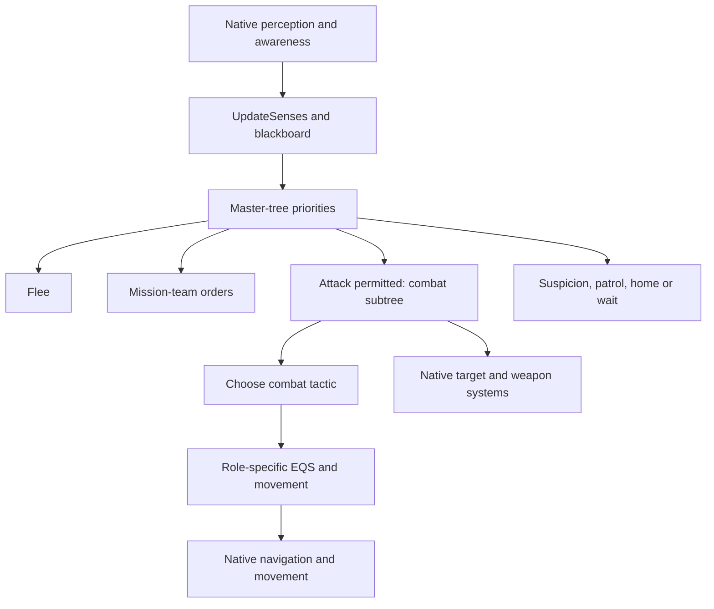

# Combat, targeting and pilot analysis

Status: **OBSERVED static editor source/configuration; gameplay NOT_PERFORMED.** Reviewed 2026-09-21. Evidence is the preserved `ai-research-collection-20260921T030437Z-f7d8e930` export, applicable to the recorded MW5 Editor 1.1.390.0e / UE 4.26.2 collection. Shipping build equivalence is unverified. All 87 assets assigned to this workstream have individual dispositions in [the combat ledger](coverage/combat.json), including every available class-default export. “Reviewed” means the accessible graph/data was analyzed; it does not mean compiled native code or gameplay was observed.

The most useful conclusion is that the existing AI already separates orders, combat roles, position selection and weapon execution. A companion can add squad-level judgments without immediately replacing the difficult native movement and shooting systems. The exported logic supports concrete hypotheses about coordination; it does not establish that an external controller can issue accepted commands or outperform vanilla.

## How a mech chooses work

The runtime `RootNode` of `BT_MechMasterTree` has three ordered alternatives: initialize a jump-jet-check blackboard flag when absent, run non-idle work, or wait. Non-idle work is itself ordered: flee, mission-team orders, attack/combat, investigate suspicion, patrol, then home/ambient behavior. Services update senses, select a combat target, feather jump jets and check navigation recovery. The ordering is read from runtime `Children` links, not the graph's visual positions. Mission orders can therefore take priority over the normal combat branch, but the tree's `MissionOrders` value alone does not establish whether a human, mission script or other system created the order. [S047 lines 480–558](<C:/Users/jlewi/OneDrive/Documents/ChatGPT/MW5 LANCEMATE COMPANION/research/evidence/editor-source/ai-research-collection-20260921T030437Z-f7d8e930/047-BT_MechMasterTree-source.COPY:480>) [S047 lines 561–710](<C:/Users/jlewi/OneDrive/Documents/ChatGPT/MW5 LANCEMATE COMPANION/research/evidence/editor-source/ai-research-collection-20260921T030437Z-f7d8e930/047-BT_MechMasterTree-source.COPY:561>)

This diagram describes dependencies, not simultaneous guaranteed execution. Selector branches are priority alternatives. `CanAttack` reads the blackboard boolean `Attack`; it does not check ammunition, line of fire or weapon readiness. `HasCombatTarget` checks object validity. The controller class-default export connects a master behavior tree and native target-selection, optimal-range and weapon-control components, but its Blueprint graph is empty. Initial `CombatTactic=None` and `PrimaryCombatTactic=None` values are defaults, not evidence that an active mech has no role. [S169 lines 29–110](<C:/Users/jlewi/OneDrive/Documents/ChatGPT/MW5 LANCEMATE COMPANION/research/evidence/editor-source/ai-research-collection-20260921T030437Z-f7d8e930/169-BTDecorator_CanAttack-source.COPY:29>) [S171 lines 25–92](<C:/Users/jlewi/OneDrive/Documents/ChatGPT/MW5 LANCEMATE COMPANION/research/evidence/editor-source/ai-research-collection-20260921T030437Z-f7d8e930/171-BTDecorator_HasCombatTarget-source.COPY:25>) [S009 lines 10–28](<C:/Users/jlewi/OneDrive/Documents/ChatGPT/MW5 LANCEMATE COMPANION/research/evidence/editor-source/ai-research-collection-20260921T030437Z-f7d8e930/009-MechAIController-source.COPY:10>) [D009 lines 53–85](<C:/Users/jlewi/OneDrive/Documents/ChatGPT/MW5 LANCEMATE COMPANION/research/evidence/editor-source/ai-research-collection-20260921T030437Z-f7d8e930/009-MechAIController-defaults.COPY:53>)

## Observation and target selection

`UpdateSenses` binds awareness-change and newly-known-target callbacks. While the service is active, those callbacks run a sense reaction, update idle state, and try appropriate power-up behavior. The reaction uses the current combat target when valid, otherwise asks native awareness for the unit with maximum awareness. It then requests sensor data: strength at or below zero clears suspicion/target-location keys; strength between zero and one supplies a suspicion actor and last-known location. A strength-equals-one node exists without a connected consuming branch, so this export does not establish a special “fully seen therefore attack” action at that node. The sensor-data lookup's success return is ignored. [S194 lines 530–599](<C:/Users/jlewi/OneDrive/Documents/ChatGPT/MW5 LANCEMATE COMPANION/research/evidence/editor-source/ai-research-collection-20260921T030437Z-f7d8e930/194-BTService_UpdateSenses-source.COPY:530>) [S194 lines 1331–1716](<C:/Users/jlewi/OneDrive/Documents/ChatGPT/MW5 LANCEMATE COMPANION/research/evidence/editor-source/ai-research-collection-20260921T030437Z-f7d8e930/194-BTService_UpdateSenses-source.COPY:1331>) [S194 lines 1969–2255](<C:/Users/jlewi/OneDrive/Documents/ChatGPT/MW5 LANCEMATE COMPANION/research/evidence/editor-source/ai-research-collection-20260921T030437Z-f7d8e930/194-BTService_UpdateSenses-source.COPY:1969>) [S194 lines 2482–2571](<C:/Users/jlewi/OneDrive/Documents/ChatGPT/MW5 LANCEMATE COMPANION/research/evidence/editor-source/ai-research-collection-20260921T030437Z-f7d8e930/194-BTService_UpdateSenses-source.COPY:2482>)

The tick path considers distance to the player squad, currently perceived hostiles and native awareness. Its configured player distance is 1000 metres, converted explicitly by multiplying by 100 before squaring. Blackboard `IdleDistance` can override it when positive. `ShouldActImmediately` returns true for `IgnoreAutoPowerUp`, non-None mission orders, or `ForceActive`. This does not establish hidden-enemy visibility: player-distance activation and knowledge of an enemy are different inputs. One immediate-path `SetIdle` call lacks its controller argument, and a power-down helper call is disconnected. Those fragments are recorded as limitations rather than interpreted as guaranteed functioning behavior. [S194 lines 599–1330](<C:/Users/jlewi/OneDrive/Documents/ChatGPT/MW5 LANCEMATE COMPANION/research/evidence/editor-source/ai-research-collection-20260921T030437Z-f7d8e930/194-BTService_UpdateSenses-source.COPY:599>) [S194 lines 2816–2998](<C:/Users/jlewi/OneDrive/Documents/ChatGPT/MW5 LANCEMATE COMPANION/research/evidence/editor-source/ai-research-collection-20260921T030437Z-f7d8e930/194-BTService_UpdateSenses-source.COPY:2816>) [D194 lines 1–17](<C:/Users/jlewi/OneDrive/Documents/ChatGPT/MW5 LANCEMATE COMPANION/research/evidence/editor-source/ai-research-collection-20260921T030437Z-f7d8e930/194-BTService_UpdateSenses-defaults.COPY:1>)

The conveniently named `HasLineOfSight` decorator calls native `IsActorVisible` with a **two-second threshold**. Treat that as a native visibility-history predicate until observed; it is not proof that a shot fired now has unobstructed geometry. Likewise `SelectTarget` inside `UpdateSenses` contains a minimum-`ActorsTargetingMe` helper, but no connected caller in this export. It cannot be credited as the active target-selection algorithm. The active master service invokes native combat-target selection; its scoring body remains unavailable. [S172 lines 47–234](<C:/Users/jlewi/OneDrive/Documents/ChatGPT/MW5 LANCEMATE COMPANION/research/evidence/editor-source/ai-research-collection-20260921T030437Z-f7d8e930/172-BTDecorator_HasLineOfSight-source.COPY:47>) [S194 lines 1717–1968](<C:/Users/jlewi/OneDrive/Documents/ChatGPT/MW5 LANCEMATE COMPANION/research/evidence/editor-source/ai-research-collection-20260921T030437Z-f7d8e930/194-BTService_UpdateSenses-source.COPY:1717>) [S047 lines 665–669](<C:/Users/jlewi/OneDrive/Documents/ChatGPT/MW5 LANCEMATE COMPANION/research/evidence/editor-source/ai-research-collection-20260921T030437Z-f7d8e930/047-BT_MechMasterTree-source.COPY:665>)

The `SensorData` table exports its row-struct name only, with no rows. Consequently this collection does not expose the actual sensor configuration table contents. The `MechTargetComponent` is mainly paper-doll and marker presentation, not a substitute for the native targeting algorithm. Its weight-class marker fragment also has incomplete connections. [S193 lines 1–9](<C:/Users/jlewi/OneDrive/Documents/ChatGPT/MW5 LANCEMATE COMPANION/research/evidence/editor-source/ai-research-collection-20260921T030437Z-f7d8e930/193-SensorData-source.COPY:1>) [S017 lines 2654–2927](<C:/Users/jlewi/OneDrive/Documents/ChatGPT/MW5 LANCEMATE COMPANION/research/evidence/editor-source/ai-research-collection-20260921T030437Z-f7d8e930/017-MechTargetComponent-source.COPY:2654>) [S017 lines 2928–3104](<C:/Users/jlewi/OneDrive/Documents/ChatGPT/MW5 LANCEMATE COMPANION/research/evidence/editor-source/ai-research-collection-20260921T030437Z-f7d8e930/017-MechTargetComponent-source.COPY:2928>) [S017 lines 3695–4430](<C:/Users/jlewi/OneDrive/Documents/ChatGPT/MW5 LANCEMATE COMPANION/research/evidence/editor-source/ai-research-collection-20260921T030437Z-f7d8e930/017-MechTargetComponent-source.COPY:3695>)

## Combat roles and their real branch order

`BT_MechCombat` first requires a target. It can clear the tether when health is at or below 0.9, then selects navigation recovery before role-specific behavior. The role alternatives are Ranged, Indirect, Tank, Mobile and HitAndRun, followed by an unconditional Ranged fallback. Clearing a tether is not equivalent to retreating or protecting a damaged mech. The role-picker instance uses 1.25 seconds with 0.25 deviation. [S057 lines 371–397](<C:/Users/jlewi/OneDrive/Documents/ChatGPT/MW5 LANCEMATE COMPANION/research/evidence/editor-source/ai-research-collection-20260921T030437Z-f7d8e930/057-BT_MechCombat-source.COPY:371>) [S057 lines 448–538](<C:/Users/jlewi/OneDrive/Documents/ChatGPT/MW5 LANCEMATE COMPANION/research/evidence/editor-source/ai-research-collection-20260921T030437Z-f7d8e930/057-BT_MechCombat-source.COPY:448>)

The picker tries the assigned primary tactic when its suitability check passes. Otherwise:

1. A Light mech becomes HitAndRun.
2. With native optimal range above the converted 179 m boundary, non-LRM capability in the long-range interval yields Ranged; otherwise it chooses Indirect.
3. In the remaining branch, Heavy/Assault becomes Tank and the other weights become Mobile.

Primary checks are not identical to those fallback rules. Mobile requires a valid target, close-range capability and Light/Medium weight. Tank permits both target-valid and target-invalid execution outputs into its close-capability check, then requires Medium/Heavy/Assault. Indirect asks whether the mech is LRM capable; Ranged checks the 179–2000 interval; HitAndRun checks Light/Medium. Native “optimal range,” “capable” and LRM calculations are not available here. See the earlier [assignment trace](AI_ASSIGNMENT_TRACE.md) for the remaining assignment boundary. [S055 lines 253–394](<C:/Users/jlewi/OneDrive/Documents/ChatGPT/MW5 LANCEMATE COMPANION/research/evidence/editor-source/ai-research-collection-20260921T030437Z-f7d8e930/055-BTService_PickCombatTactic-source.COPY:253>) [S055 lines 416–800](<C:/Users/jlewi/OneDrive/Documents/ChatGPT/MW5 LANCEMATE COMPANION/research/evidence/editor-source/ai-research-collection-20260921T030437Z-f7d8e930/055-BTService_PickCombatTactic-source.COPY:416>) [S055 lines 849–1300](<C:/Users/jlewi/OneDrive/Documents/ChatGPT/MW5 LANCEMATE COMPANION/research/evidence/editor-source/ai-research-collection-20260921T030437Z-f7d8e930/055-BTService_PickCombatTactic-source.COPY:849>) [D055 lines 1–8](<C:/Users/jlewi/OneDrive/Documents/ChatGPT/MW5 LANCEMATE COMPANION/research/evidence/editor-source/ai-research-collection-20260921T030437Z-f7d8e930/055-BTService_PickCombatTactic-defaults.COPY:1>)

| Role | Root-reachable exported behavior | Important limit |
|---|---|---|
| Ranged | With visibility, supplies RangedCircle to shared movement. Otherwise queries BruteForceCircle and moves while negative visibility applies, then waits. | Old jump-jet/simple-parallel nodes are serialized but disconnected from the runtime root. |
| Indirect | Similar sequence using IndirectCircle, with brute-force visibility recovery and waits. | “Indirect” does not itself prove a ballistic solution or safe firing position. |
| Mobile | Dead-zone hysteresis can activate repeated evasive-position queries; otherwise uses BruteForceCircle through shared movement. | The trigger is a native dead-zone predicate, not damage intake or incoming-projectile prediction. |
| Tank | First uses Mobile while recently damaged; then tries MechTankCircle/shared movement, followed by visibility recovery and wait. | This is a mech tactic. It is separate from a tank vehicle's behavior tree. |
| HitAndRun | Beyond 500 m, uses RushTarget/shared movement. Otherwise tries melee behind a 30-second cooldown, then start/end rush movement with conditional jump jets. | Timing, physical movement and resulting exposure still depend on native systems. |

Evidence: [S061 lines 342–520](<C:/Users/jlewi/OneDrive/Documents/ChatGPT/MW5 LANCEMATE COMPANION/research/evidence/editor-source/ai-research-collection-20260921T030437Z-f7d8e930/061-BT_MechCombat_Ranged-source.COPY:342>) [S059 lines 250–361](<C:/Users/jlewi/OneDrive/Documents/ChatGPT/MW5 LANCEMATE COMPANION/research/evidence/editor-source/ai-research-collection-20260921T030437Z-f7d8e930/059-BT_MechCombat_Indirect-source.COPY:250>) [S060 lines 339–502](<C:/Users/jlewi/OneDrive/Documents/ChatGPT/MW5 LANCEMATE COMPANION/research/evidence/editor-source/ai-research-collection-20260921T030437Z-f7d8e930/060-BT_MechCombat_Mobile-source.COPY:339>) [S062 lines 526–792](<C:/Users/jlewi/OneDrive/Documents/ChatGPT/MW5 LANCEMATE COMPANION/research/evidence/editor-source/ai-research-collection-20260921T030437Z-f7d8e930/062-BT_MechCombat_Tank-source.COPY:526>) [S058 lines 560–780](<C:/Users/jlewi/OneDrive/Documents/ChatGPT/MW5 LANCEMATE COMPANION/research/evidence/editor-source/ai-research-collection-20260921T030437Z-f7d8e930/058-BT_MechCombat_HitAndRun-source.COPY:560>).

Two stateful details matter for a tactical layer. “Recently damaged” means a positive last-damage timestamp and current time no later than timestamp plus the configured threshold; the Tank instance sets 15 seconds. Mobile's service increments its dead-zone counter on positive ticks and decrements it otherwise, clamps between zero and eight, enables evasion at eight and disables only at zero. The Mobile instance uses one-second intervals. This hysteresis discourages instant toggling but is not a universal exact eight-second response guarantee. [S049 lines 33–142](<C:/Users/jlewi/OneDrive/Documents/ChatGPT/MW5 LANCEMATE COMPANION/research/evidence/editor-source/ai-research-collection-20260921T030437Z-f7d8e930/049-BTDecorator_HasBeenDamagedRecently-source.COPY:33>) [S053 lines 70–372](<C:/Users/jlewi/OneDrive/Documents/ChatGPT/MW5 LANCEMATE COMPANION/research/evidence/editor-source/ai-research-collection-20260921T030437Z-f7d8e930/053-BTService_CheckEvasiveManeuvers-source.COPY:70>) [D053 lines 1–8](<C:/Users/jlewi/OneDrive/Documents/ChatGPT/MW5 LANCEMATE COMPANION/research/evidence/editor-source/ai-research-collection-20260921T030437Z-f7d8e930/053-BTService_CheckEvasiveManeuvers-defaults.COPY:1>) [S060 lines 485–491](<C:/Users/jlewi/OneDrive/Documents/ChatGPT/MW5 LANCEMATE COMPANION/research/evidence/editor-source/ai-research-collection-20260921T030437Z-f7d8e930/060-BT_MechCombat_Mobile-source.COPY:485>) [S062 lines 737–739](<C:/Users/jlewi/OneDrive/Documents/ChatGPT/MW5 LANCEMATE COMPANION/research/evidence/editor-source/ai-research-collection-20260921T030437Z-f7d8e930/062-BT_MechCombat_Tank-source.COPY:737>)

## Choosing positions: preferences are not guarantees

EQS generates points and applies tests and scores. A score can prefer a clear route without rejecting an obstructed one. Comments such as “Filter out points without LOS” do not override serialized `TestPurpose=Score`. Native tests, providers and the actual result selector still determine the final point.

| Query | Candidate geometry/order | What the export supports |
|---|---|---|
| BruteForceCircle | Donut, then circle around combat target | Donut has path filtering; trace is scoring. Fallback differs. |
| RangedCircle | 5000, 15000, 30000 donuts, then 12000 target circle | Main donuts explicitly trace-filter. The final circle has no trace filter. |
| IndirectCircle | 5000 and 15000 donuts, then 12000 target circle | Optimal-range/path/spacing/tether scores; no explicit trace test. |
| MechTankCircle | 5000 donut, then 12000 target circle | Optimal-range and trace scores; trace is not a hard filter. |
| StartRush | 12000 donut | Path filter plus directional and distance preferences. |
| EndRush | 24000 donut | Direction/spacing/path scores; no explicit hard path filter. |
| RushTarget | 5000 cone, then 10000 target circle | Cone path filter; fallback path score. |
| TankCombatCircle | 4000 donut, then 15000 target circle | Runtime options exclude a separately serialized Option_0; active trace is a score. |
| TankLRMBruteForce | 4000 donut, then 50000 target circle | Path/trace and range scores; no explicit hard path/trace filter in serialized tests. |

Geometry values in this table are **raw exported spatial units**. Other Blueprint functions explicitly convert metres by 100, but the table does not relabel every native provider as metres without evidence. Donut and fallback options have different tests. A companion must receive independently established path and visibility prerequisites for a proposed point; it must not infer them from the query's name. [S064 lines 249–398](<C:/Users/jlewi/OneDrive/Documents/ChatGPT/MW5 LANCEMATE COMPANION/research/evidence/editor-source/ai-research-collection-20260921T030437Z-f7d8e930/064-EQS_BruteForceCircle-source.COPY:249>) [S065 lines 167–227](<C:/Users/jlewi/OneDrive/Documents/ChatGPT/MW5 LANCEMATE COMPANION/research/evidence/editor-source/ai-research-collection-20260921T030437Z-f7d8e930/065-EQS_HitAndRun_EndRush-source.COPY:167>) [S066 lines 178–251](<C:/Users/jlewi/OneDrive/Documents/ChatGPT/MW5 LANCEMATE COMPANION/research/evidence/editor-source/ai-research-collection-20260921T030437Z-f7d8e930/066-EQS_HitAndRun_StartRush-source.COPY:178>) [S067 lines 200–346](<C:/Users/jlewi/OneDrive/Documents/ChatGPT/MW5 LANCEMATE COMPANION/research/evidence/editor-source/ai-research-collection-20260921T030437Z-f7d8e930/067-EQS_IndirectCircle-source.COPY:200>) [S068 lines 171–277](<C:/Users/jlewi/OneDrive/Documents/ChatGPT/MW5 LANCEMATE COMPANION/research/evidence/editor-source/ai-research-collection-20260921T030437Z-f7d8e930/068-EQS_MechTankCircle-source.COPY:171>) [S069 lines 349–617](<C:/Users/jlewi/OneDrive/Documents/ChatGPT/MW5 LANCEMATE COMPANION/research/evidence/editor-source/ai-research-collection-20260921T030437Z-f7d8e930/069-EQS_RangedCircle-source.COPY:349>) [S070 lines 179–279](<C:/Users/jlewi/OneDrive/Documents/ChatGPT/MW5 LANCEMATE COMPANION/research/evidence/editor-source/ai-research-collection-20260921T030437Z-f7d8e930/070-EQS_RushTarget-source.COPY:179>) [S071 lines 324–529](<C:/Users/jlewi/OneDrive/Documents/ChatGPT/MW5 LANCEMATE COMPANION/research/evidence/editor-source/ai-research-collection-20260921T030437Z-f7d8e930/071-EQS_TankCombatCircle-source.COPY:324>) [S072 lines 210–372](<C:/Users/jlewi/OneDrive/Documents/ChatGPT/MW5 LANCEMATE COMPANION/research/evidence/editor-source/ai-research-collection-20260921T030437Z-f7d8e930/072-EQS_TankLRMBruteForce-source.COPY:210>)

## Firing, heat and melee

`MechFireAtCombatTarget` validates a target, sets focus, requests `FireAt`, sets movement-relative-to-target behavior, and immediately finishes the task. `MechFaceCombatTarget` likewise finishes after requesting facing. Neither is evidence of a fired round, a hit, accepted low-level control or completed rotation. The native `AIWeaponControlSystemComponent` and optimal-range component are present in the controller defaults, but their weapon scheduling, aim adjustment and heat arithmetic are not exported as Blueprint bodies. [S056 lines 48–221](<C:/Users/jlewi/OneDrive/Documents/ChatGPT/MW5 LANCEMATE COMPANION/research/evidence/editor-source/ai-research-collection-20260921T030437Z-f7d8e930/056-BTTask_MechFireAtCombatTarget-source.COPY:48>) [S046 lines 296–390](<C:/Users/jlewi/OneDrive/Documents/ChatGPT/MW5 LANCEMATE COMPANION/research/evidence/editor-source/ai-research-collection-20260921T030437Z-f7d8e930/046-BTTask_MechFaceCombatTarget-source.COPY:296>) [D009 lines 10–16](<C:/Users/jlewi/OneDrive/Documents/ChatGPT/MW5 LANCEMATE COMPANION/research/evidence/editor-source/ai-research-collection-20260921T030437Z-f7d8e930/009-MechAIController-defaults.COPY:10>) [D009 lines 64–76](<C:/Users/jlewi/OneDrive/Documents/ChatGPT/MW5 LANCEMATE COMPANION/research/evidence/editor-source/ai-research-collection-20260921T030437Z-f7d8e930/009-MechAIController-defaults.COPY:64>)

The melee-start decorator asks native `IsMeleeDesirable`, checks health and a mech target within range, then relies on parameters derived from exact combat-role tags. Defaults are 100 m, 0.5 minimum health and 10 s. Juggernaut changes them to 250/0.15/10, Brawler to 250/0.4/10, Skirmisher to 300/0.4/15. These tests execute sequentially: multiple tags allow a later match to overwrite an earlier one. This is not a single mutually exclusive role switch. [S179 lines 210–615](<C:/Users/jlewi/OneDrive/Documents/ChatGPT/MW5 LANCEMATE COMPANION/research/evidence/editor-source/ai-research-collection-20260921T030437Z-f7d8e930/179-BTDecorator_ShouldStartMeleeAttack-source.COPY:210>) [S179 lines 616–1217](<C:/Users/jlewi/OneDrive/Documents/ChatGPT/MW5 LANCEMATE COMPANION/research/evidence/editor-source/ai-research-collection-20260921T030437Z-f7d8e930/179-BTDecorator_ShouldStartMeleeAttack-source.COPY:616>)

The continue decorator initializes its local timer and thresholds from blackboard, then checks target, range, timer and health. Its tick decrements the **local** timer. A separate blackboard timer-write node is disconnected, so the collection does not support a continuously synchronized blackboard countdown. The health-stage controlled-pawn cast failure routes to true, another reason a companion needs its own identity/authority safeguards. The melee subtree itself limits its loop to 30 seconds and sets `ShouldMelee` true and has a second write with an omitted bool value (requiring native-default confirmation); actual strike execution remains native. [S178 lines 188–320](<C:/Users/jlewi/OneDrive/Documents/ChatGPT/MW5 LANCEMATE COMPANION/research/evidence/editor-source/ai-research-collection-20260921T030437Z-f7d8e930/178-BTDecorator_ShouldContineMeleeAttack-source.COPY:188>) [S178 lines 321–1022](<C:/Users/jlewi/OneDrive/Documents/ChatGPT/MW5 LANCEMATE COMPANION/research/evidence/editor-source/ai-research-collection-20260921T030437Z-f7d8e930/178-BTDecorator_ShouldContineMeleeAttack-source.COPY:321>) [S063 lines 208–278](<C:/Users/jlewi/OneDrive/Documents/ChatGPT/MW5 LANCEMATE COMPANION/research/evidence/editor-source/ai-research-collection-20260921T030437Z-f7d8e930/063-BT_MechMovement_MeleeRush-source.COPY:208>)

## Configuration and pilot effects

Native API **declarations/documentation**, rather than implementation, describe base accuracy by range, apparent lateral-motion and evasion modifiers, lethality for critical-component choice, coordination for focus fire, weighted mech parts, an overheat-willingness deck, and armor-damage shielding. They identify what knobs are intended to influence; they do not reveal the exact combined calculation. Several accuracy-curve values exceed one despite the documented [0,1] description, so a curve value such as 1.5 must not be presented as an observed 150% hit rate. [API lines 298511–298535](<C:/Users/jlewi/OneDrive/Documents/ChatGPT/MW5 LANCEMATE COMPANION/research/evidence/editor-source/ai-research-collection-20260921T030437Z-f7d8e930/unreal-api-reference.txt:298511>)

| Configuration | Lethality | Shielding | Coordination | Explicit overheat willingness |
|---|---:|---:|---|---:|
| Recruit | 0.25 | omitted | omitted | 0.20 |
| Green | 0.40 | 0.05 | omitted | 0.15 |
| Regular | 0.55 | 0.10 | Small | 0.10 |
| Veteran | 0.675 | 0.25 | Moderate | 0.05 |
| Elite | 0.80 | 0.40 | Large | omitted |
| Lancemate | 0.80 | omitted | Large | omitted |
| Boss | 1.00 | 0.50 | Large | omitted |
| Bounty Hunter | 1.00 | 0.65 | Large | omitted |

“Omitted” means inherited/default value unknown from that particular export, not zero. These are named data assets, not confirmed live bindings. Their referenced accuracy curves, part weights and battle-value multipliers also differ. Ordinary configuration names therefore do not establish a separate friend/enemy planning algorithm, and increasing skill can change aim/damage resistance without adding a smarter tactical plan. All 25 config/curve entries 101–125 are individually recorded in the ledger. [S120 lines 1–13](<C:/Users/jlewi/OneDrive/Documents/ChatGPT/MW5 LANCEMATE COMPANION/research/evidence/editor-source/ai-research-collection-20260921T030437Z-f7d8e930/120-Recruit_BehaviorConfig-source.COPY:1>) [S115 lines 1–14](<C:/Users/jlewi/OneDrive/Documents/ChatGPT/MW5 LANCEMATE COMPANION/research/evidence/editor-source/ai-research-collection-20260921T030437Z-f7d8e930/115-Green_BehaviorConfig-source.COPY:1>) [S122 lines 1–14](<C:/Users/jlewi/OneDrive/Documents/ChatGPT/MW5 LANCEMATE COMPANION/research/evidence/editor-source/ai-research-collection-20260921T030437Z-f7d8e930/122-Regular_BehaviorConfig-source.COPY:1>) [S125 lines 1–15](<C:/Users/jlewi/OneDrive/Documents/ChatGPT/MW5 LANCEMATE COMPANION/research/evidence/editor-source/ai-research-collection-20260921T030437Z-f7d8e930/125-Veteran_BehaviorConfig-source.COPY:1>) [S113 lines 1–14](<C:/Users/jlewi/OneDrive/Documents/ChatGPT/MW5 LANCEMATE COMPANION/research/evidence/editor-source/ai-research-collection-20260921T030437Z-f7d8e930/113-Elite_BehaviorConfig-source.COPY:1>) [S118 lines 1–9](<C:/Users/jlewi/OneDrive/Documents/ChatGPT/MW5 LANCEMATE COMPANION/research/evidence/editor-source/ai-research-collection-20260921T030437Z-f7d8e930/118-LanceMateBehaviorConfig-source.COPY:1>) [S103 lines 1–12](<C:/Users/jlewi/OneDrive/Documents/ChatGPT/MW5 LANCEMATE COMPANION/research/evidence/editor-source/ai-research-collection-20260921T030437Z-f7d8e930/103-Boss_BehaviorConfig-source.COPY:1>) [S105 lines 1–13](<C:/Users/jlewi/OneDrive/Documents/ChatGPT/MW5 LANCEMATE COMPANION/research/evidence/editor-source/ai-research-collection-20260921T030437Z-f7d8e930/105-BountyHunter_BehaviorConfig-source.COPY:1>)

`PilotSkillGrowth` evaluates a valid curve at **floor(native skill level)**. It adds general gunnery damage and one matching weapon-subskill result; shield/evasion functions add the matching skill and piloting-curve results. Heat-capacity/cooling functions use HeatManagement; their similarly named piloting curves exist in defaults but are not wired into those functions. Its AI-config wrapper forwards `DefaultAIBehaviourConfig` with zero extra accuracy, lethality and DPS bonuses and false boss/focus flags. Existing pilot progression is not model training or learned tactics. [S208 lines 1643–2850](<C:/Users/jlewi/OneDrive/Documents/ChatGPT/MW5 LANCEMATE COMPANION/research/evidence/editor-source/ai-research-collection-20260921T030437Z-f7d8e930/208-PilotSkillGrowth-source.COPY:1643>) [S208 lines 5561–5631](<C:/Users/jlewi/OneDrive/Documents/ChatGPT/MW5 LANCEMATE COMPANION/research/evidence/editor-source/ai-research-collection-20260921T030437Z-f7d8e930/208-PilotSkillGrowth-source.COPY:5561>) [D208 lines 1–13](<C:/Users/jlewi/OneDrive/Documents/ChatGPT/MW5 LANCEMATE COMPANION/research/evidence/editor-source/ai-research-collection-20260921T030437Z-f7d8e930/208-PilotSkillGrowth-defaults.COPY:1>)

The referenced endpoint values include subskill damage +0.2 at level 10, shielding +0.3 at 10, heat capacity +0.2 at 18, cooling +0.2 at 10, and evasive modifier 1 at 10. General gunnery and piloting shield/evasion curves serialize zero-valued keys. Actual hit chances, effective damage and reachable skill levels require native rules and observation; endpoint values are not guarantees. [S202 lines 1–8](<C:/Users/jlewi/OneDrive/Documents/ChatGPT/MW5 LANCEMATE COMPANION/research/evidence/editor-source/ai-research-collection-20260921T030437Z-f7d8e930/202-EvasivePercentageIncrease-source.COPY:1>) [S203 lines 1–8](<C:/Users/jlewi/OneDrive/Documents/ChatGPT/MW5 LANCEMATE COMPANION/research/evidence/editor-source/ai-research-collection-20260921T030437Z-f7d8e930/203-GunneryDamageBonus-source.COPY:1>) [S204 lines 1–8](<C:/Users/jlewi/OneDrive/Documents/ChatGPT/MW5 LANCEMATE COMPANION/research/evidence/editor-source/ai-research-collection-20260921T030437Z-f7d8e930/204-GunnerySubskillDamageBonus-source.COPY:1>) [S205 lines 1–8](<C:/Users/jlewi/OneDrive/Documents/ChatGPT/MW5 LANCEMATE COMPANION/research/evidence/editor-source/ai-research-collection-20260921T030437Z-f7d8e930/205-HeatCapIncrease-source.COPY:1>) [S206 lines 1–8](<C:/Users/jlewi/OneDrive/Documents/ChatGPT/MW5 LANCEMATE COMPANION/research/evidence/editor-source/ai-research-collection-20260921T030437Z-f7d8e930/206-HeatCoolingIncrease-source.COPY:1>) [S207 lines 1–8](<C:/Users/jlewi/OneDrive/Documents/ChatGPT/MW5 LANCEMATE COMPANION/research/evidence/editor-source/ai-research-collection-20260921T030437Z-f7d8e930/207-PilotSkillEvasiveCurve-source.COPY:1>) [S212 lines 1–8](<C:/Users/jlewi/OneDrive/Documents/ChatGPT/MW5 LANCEMATE COMPANION/research/evidence/editor-source/ai-research-collection-20260921T030437Z-f7d8e930/212-PilotSkillShieldingCurve-source.COPY:1>) [S213 lines 1–8](<C:/Users/jlewi/OneDrive/Documents/ChatGPT/MW5 LANCEMATE COMPANION/research/evidence/editor-source/ai-research-collection-20260921T030437Z-f7d8e930/213-ShieldingPercentageIncrease-source.COPY:1>)

Post-mission commendation logic is also visible. It picks the highest satisfied star tier for evasion points, armor damage minus structure damage, max(attack heat minus 50 per overheat,0), weapon-category hostile damage, and flank count. Missile and Artemis records run separately and may each append an award. These graphs consume tracking data; the collection does not contain the native tracking computation. They are useful for understanding existing progression, not for implementing campaign persistence in this package. [S208 lines 2851–4110](<C:/Users/jlewi/OneDrive/Documents/ChatGPT/MW5 LANCEMATE COMPANION/research/evidence/editor-source/ai-research-collection-20260921T030437Z-f7d8e930/208-PilotSkillGrowth-source.COPY:2851>) [S208 lines 4111–5560](<C:/Users/jlewi/OneDrive/Documents/ChatGPT/MW5 LANCEMATE COMPANION/research/evidence/editor-source/ai-research-collection-20260921T030437Z-f7d8e930/208-PilotSkillGrowth-source.COPY:4111>)

## Special-case assets and misleading names

The MechCon2018 boss assets cannot safely be summarized as “switches from ranged to regular combat when hurt or approached.” The root checks `AreMinionsTooDamaged` and `HasEnemyBeenNearby`. The damage service's default uses **HasTakenTooMuchDamage**, enters its update only when that flag is already true, and compares a literal zero against its health threshold. The proximity service also gates on an already-true flag. Additionally, its player-squad EQS context returns the first valid `MWSquad` found without filtering player/team. These are concrete source inconsistencies and usage questions, not proof of a present shipping-game bug. [S094 lines 114–282](<C:/Users/jlewi/OneDrive/Documents/ChatGPT/MW5 LANCEMATE COMPANION/research/evidence/editor-source/ai-research-collection-20260921T030437Z-f7d8e930/094-BTService_MechCon2018Boss_CheckForDamage-source.COPY:114>) [D094 lines 1–6](<C:/Users/jlewi/OneDrive/Documents/ChatGPT/MW5 LANCEMATE COMPANION/research/evidence/editor-source/ai-research-collection-20260921T030437Z-f7d8e930/094-BTService_MechCon2018Boss_CheckForDamage-defaults.COPY:1>) [S095 lines 110–311](<C:/Users/jlewi/OneDrive/Documents/ChatGPT/MW5 LANCEMATE COMPANION/research/evidence/editor-source/ai-research-collection-20260921T030437Z-f7d8e930/095-BTService_MechCon2018Boss_CheckForNearbyEnemy-source.COPY:110>) [S096 lines 126–184](<C:/Users/jlewi/OneDrive/Documents/ChatGPT/MW5 LANCEMATE COMPANION/research/evidence/editor-source/ai-research-collection-20260921T030437Z-f7d8e930/096-BT_MechCon2018Boss-source.COPY:126>) [S098 lines 1–13](<C:/Users/jlewi/OneDrive/Documents/ChatGPT/MW5 LANCEMATE COMPANION/research/evidence/editor-source/ai-research-collection-20260921T030437Z-f7d8e930/098-Blackboard_Mech_MechCon2018Boss-source.COPY:1>) [S099 lines 117–184](<C:/Users/jlewi/OneDrive/Documents/ChatGPT/MW5 LANCEMATE COMPANION/research/evidence/editor-source/ai-research-collection-20260921T030437Z-f7d8e930/099-Context_MechCon2018Boss_PlayerSquadMechs-source.COPY:117>)

## Worked tactical examples and next experiments

These examples are **PROPOSED hypotheses**, not gameplay results.

**A damaged heavy holding a firing position.** The Tank tactic's recent-damage predicate can temporarily select Mobile. Repeated companion reposition orders could fight that native response. A better first recommendation is to preserve an established task unless observations show danger or a concrete improved destination. Smallest later experiment: one designated heavy, fixed loadout/enemy, compare role, damage timestamp, orders and position through one damage event and the following 15 seconds. This tests timing and interaction, not just whether a command was sent. [S049 lines 33–142](<C:/Users/jlewi/OneDrive/Documents/ChatGPT/MW5 LANCEMATE COMPANION/research/evidence/editor-source/ai-research-collection-20260921T030437Z-f7d8e930/049-BTDecorator_HasBeenDamagedRecently-source.COPY:33>) [S062 lines 526–792](<C:/Users/jlewi/OneDrive/Documents/ChatGPT/MW5 LANCEMATE COMPANION/research/evidence/editor-source/ai-research-collection-20260921T030437Z-f7d8e930/062-BT_MechCombat_Tank-source.COPY:526>)

**A long-range lancemate loses a target behind terrain.** The native visibility predicate can retain recent visibility, while its EQS fallback may lack a hard trace filter. The companion should defer a new focus/reposition recommendation until current friendly-visible target identity and candidate path/fire prerequisites are supplied. Smallest experiment: controlled occlusion with a static target, record native visibility predicate, independent geometric observation and chosen EQS point. Do not infer hidden target position from an old contact. [S172 lines 47–234](<C:/Users/jlewi/OneDrive/Documents/ChatGPT/MW5 LANCEMATE COMPANION/research/evidence/editor-source/ai-research-collection-20260921T030437Z-f7d8e930/172-BTDecorator_HasLineOfSight-source.COPY:47>) [S061 lines 342–520](<C:/Users/jlewi/OneDrive/Documents/ChatGPT/MW5 LANCEMATE COMPANION/research/evidence/editor-source/ai-research-collection-20260921T030437Z-f7d8e930/061-BT_MechCombat_Ranged-source.COPY:342>) [S069 lines 349–617](<C:/Users/jlewi/OneDrive/Documents/ChatGPT/MW5 LANCEMATE COMPANION/research/evidence/editor-source/ai-research-collection-20260921T030437Z-f7d8e930/069-EQS_RangedCircle-source.COPY:349>)

**Three lancemates have different loadouts.** Different native optimal-range and role outcomes are plausible even when ordered onto one target. A slow coordination layer can recommend a known target plus complementary supplied positions, retaining current behavior when data is insufficient. It cannot yet derive every weapon's effective range, ammo or heat tolerance from these asset names. Smallest experiment: a fixed mixed-loadout squad with a known visible enemy and one new order to one member; retain another as a sentinel, record native assignment and observed behavior, then interrupt with a human order. This depends on the separately gated observer and command integration. [S055 lines 416–800](<C:/Users/jlewi/OneDrive/Documents/ChatGPT/MW5 LANCEMATE COMPANION/research/evidence/editor-source/ai-research-collection-20260921T030437Z-f7d8e930/055-BTService_PickCombatTactic-source.COPY:416>) [S055 lines 849–1300](<C:/Users/jlewi/OneDrive/Documents/ChatGPT/MW5 LANCEMATE COMPANION/research/evidence/editor-source/ai-research-collection-20260921T030437Z-f7d8e930/055-BTService_PickCombatTactic-source.COPY:849>)

**Melee and close-range danger.** The exported start/continue gates have health/range/timer policy but depend on native desirability and lifecycle. Do not make “melee-capable” equivalent to “safe to rush.” A later controlled test should compare a single tagged melee unit's initial blackboard parameters and local-timer behavior, with a human release/stop path and a non-melee sentinel. [S178 lines 188–1022](<C:/Users/jlewi/OneDrive/Documents/ChatGPT/MW5 LANCEMATE COMPANION/research/evidence/editor-source/ai-research-collection-20260921T030437Z-f7d8e930/178-BTDecorator_ShouldContineMeleeAttack-source.COPY:188>) [S179 lines 616–1217](<C:/Users/jlewi/OneDrive/Documents/ChatGPT/MW5 LANCEMATE COMPANION/research/evidence/editor-source/ai-research-collection-20260921T030437Z-f7d8e930/179-BTDecorator_ShouldStartMeleeAttack-source.COPY:616>)

## Exact remaining boundaries

| Unknown | Effect on claims | Smallest targeted evidence needed later |
|---|---|---|
| Native target scoring/coordination | Cannot fully explain target switches or derive threat truth | Observe one target change with competing known contacts and config identity. |
| Weapon/heat/aim implementation | Cannot emulate accurate firing or validate “human-like” piloting | Isolated fixed-loadout firing trial with native target/heat/shot outcomes. |
| EQS provider math/result handling | Cannot guarantee a candidate is reachable, safe or visible | Record query name, chosen point and independent path/trace outcome for one query. |
| Runtime pilot/config binding | Cannot say which listed asset a particular unit uses | Observe actor identity, pilot ID and resolved config together. |
| SensorData rows and native perception | Cannot fully parameterize detection | Targeted row/property extraction only if relevant and separately authorized; no broad recollection. |
| Dormant/special assets used by scenarios | Cannot call suspicious graph fragments shipping bugs | Prove class/tree binding before testing the specific branch. |
| Control authority and order acceptance | Cannot convert these recommendations into native commands | Follow the observer/one-command handoff; transmitted message, accepted job and observed behavior are separate gates. |

No editor/game was executed for this analysis. No source/config files were modified. No gameplay optimization, autonomous piloting, campaign persistence or model training is claimed.

