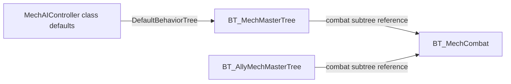

# Expanded AI source: first findings

Observed 2026-09-20 local / 2026-09-21 UTC from the user-started [expanded collection](evidence/editor-source/ai-research-collection-20260921T030437Z-f7d8e930/progress.json). Editor: recorded MW5 1.1.390.0e / UE4.26.2. These observations use completed exports whose file hashes were verified; they are source/default configuration, not live mission behavior. [Immutable partial audit](evidence/editor-source/ai-research-audit-20260921T030836Z-e264ce51/audit.json) checked all249installed files and330completed text outputs at226/249processed, without mismatches. Final collection status is tracked separately in [the collection guide](AI_SOURCE_COLLECTION.md).

## Controller and shared combat logic

**OBSERVED:** [MechAIController class defaults](evidence/editor-source/ai-research-collection-20260921T030437Z-f7d8e930/009-MechAIController-defaults.COPY), line67, set `DefaultBehaviorTree` to `BT_MechMasterTree`. Lines59/69 have `CombatTactic=None` and `PrimaryCombatTactic=None`; line75 has an empty `BehaviourConfig.AIBehaviourConfigAsset.Id`. These values do not tell us which config or tactic a mission later assigns.

**OBSERVED:** runtime subtree-task objects in [BT_MechMasterTree](evidence/editor-source/ai-research-collection-20260921T030437Z-f7d8e930/047-BT_MechMasterTree-source.COPY), lines621-625, and [BT_AllyMechMasterTree](evidence/editor-source/ai-research-collection-20260921T030437Z-f7d8e930/014-BT_AllyMechMasterTree-source.COPY), lines262-265, both reference `/Game/AI/Mech/Behaviors/Combat/BT_MechCombat`.

This diagram describes source references. It does not assign any current lancemate/enemy actor to either tree. **PROPOSED implication:** review shared combat changes against every population that actually uses that subtree; editing a shared asset cannot be presumed lancemate-only.

## Configured differences

**OBSERVED:** [LanceMateBehaviorConfig](evidence/editor-source/ai-research-collection-20260921T030437Z-f7d8e930/118-LanceMateBehaviorConfig-source.COPY), lines2-8, and [Default_BehaviorConfig](evidence/editor-source/ai-research-collection-20260921T030437Z-f7d8e930/111-Default_BehaviorConfig-source.COPY), lines3-8, serialize different values:

| Field | Lancemate-named config | Default config |
|---|---|---|
| NumCardsInOverheatWillingnessDeck | 100 | 10 |
| LethalityPercent | 0.800000 | 0.250000 |
| CoordinationLevel | Large | Not serialized in this text |

Both reference the same base accuracy, lateral-movement accuracy and evasion curves, and serialize the same mech-part target weights. The default config additionally serializes `PercentWillingnessToOverheat=0.100000`; the lancemate text omits that field. Omission is not evidence of zero or equality. The native interpretation of these settings and assignment to actual pilots remain unverified: `LethalityPercent` must not be translated into a literal kill probability from its name alone.

## Existing tactical branches and orders

**OBSERVED:** [BT_MechCombat](evidence/editor-source/ai-research-collection-20260921T030437Z-f7d8e930/057-BT_MechCombat-source.COPY), lines371-377, connects navigation recovery, Ranged, Indirect, Tank, Mobile and HitAndRun branches, followed by an undecorated Ranged fallback. Subtree references are at448-480 and tactic conditions at489-521. The connected tactic-selection service serializes `Interval=1.25`, `RandomDeviation=0.25` at529-533. These are source settings, not measured decision latency or proof that every branch runs.

**OBSERVED:** [BT_MechMasterTree](evidence/editor-source/ai-research-collection-20260921T030437Z-f7d8e930/047-BT_MechMasterTree-source.COPY), lines489-498, orders its connected selector as flee, mission orders, CanAttack/combat, suspicion/scout, patrol, home/ambient. Mission-order conditions are at561-568 and the subtree at638-641. The connected target-selection service serializes `bAutoAttack=True`, `Interval=1.0`, `RandomDeviation=0.25` at665-671.

**PROPOSED implication:** the existing mission-order route is worth tracing for the nearer tactical-control milestone. A branch priority and an exposed method do not establish accepted commands, current actor identity or human supersession. Those source chains and the isolated one-command proof remain necessary.

## Remaining questions

- Trace where mission spawning/initialization chooses root trees, behavior configs and tactics for each allegiance and pilot. Class defaults are a starting point, not the final assignment.
- Trace the native bodies behind target/tactic selection where source is available; document unavailable compiled logic explicitly.
- Establish what triggers order replacement, expiry, cancellation and player override, including control switching.
- Keep optimization hypotheses separate from findings. No observed gameplay bug, optimized AI, live tactical decision, model training or human-like gameplay result is claimed here.
