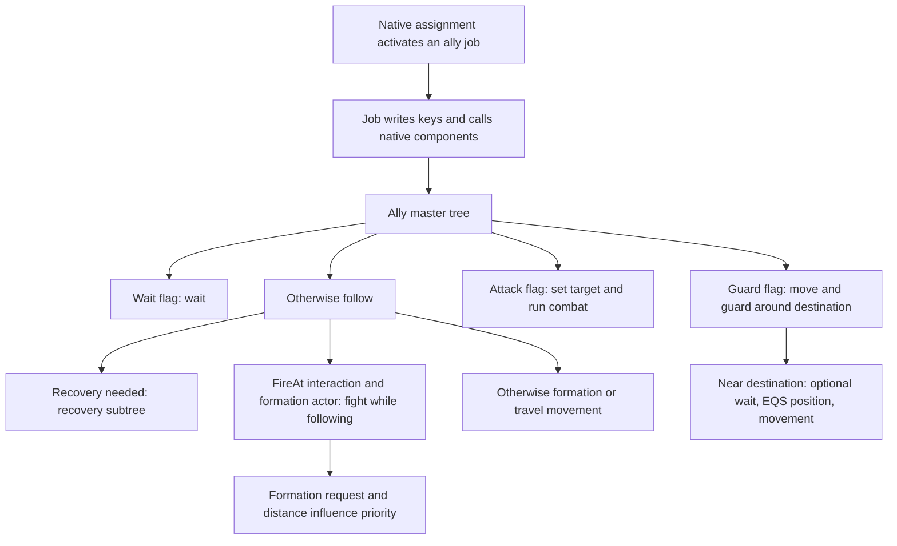

# How MW5 moves, follows and assigns work

Reviewed 2026-09-21. **OBSERVED** means observed in the collected text, not observed in gameplay. **DOCUMENTED** means a native API declaration/configuration. **PROPOSED** means an experiment or tactical recommendation. Shipping gameplay, editor execution and performance tests: **NOT_PERFORMED**.

This analysis covers all 75 assigned inventory entries: 59 available behavior/interface exports received semantic review, 14 supporting schemas/configurations received data review, and two unavailable entries have explicit dispositions. Every available class-default export in this population was also read. The machine-readable [movement coverage ledger](coverage/movement.json) records each asset, source locations and its limitations. Collection: `ai-research-collection-20260921T030437Z-f7d8e930`; applicable editor provenance: Epic 1.1.390.0e / UE 4.26.2. This does not verify the shipping Steam 1.14.390 configuration.

The review follows registered Blueprint functions/events and their connected execution/data pins, and behavior-tree runtime `RootNode`, `Children`, `Decorators` and `Services`. Unconnected nodes, unused serialized runtime objects, cached labels and editor graph positions do not establish execution. The existing [order lifecycle trace](ORDER_LIFECYCLE_TRACE.md) supplies the connected upstream posting/assignment context; the movement-side jobs were reviewed here. Native worker arbitration, formation allocation, navigation, weapons and timing internals remain unavailable.

## The practical picture

“Form On Me” does not replace combat with a simple walk toward the commander. Its job establishes following state and asks the native group component to follow a leader. The ally master tree still selects wait, guard, attack or follow behavior; the follow subtree can select recovery, fight while following, or formation movement. In combat-capable following, distance and an initial formation flag influence which branch gets priority. This explains why a source-supported tactical design should preserve native fighting during regrouping instead of assuming every regroup command is a retreat or cease-fire. Actual behavior still needs observation. [004 source, lines 249–493](evidence/editor-source/ai-research-collection-20260921T030437Z-f7d8e930/004-Ally_FollowJob-source.COPY) [004 source, lines 619–948](evidence/editor-source/ai-research-collection-20260921T030437Z-f7d8e930/004-Ally_FollowJob-source.COPY) [014 source, lines 225–305](evidence/editor-source/ai-research-collection-20260921T030437Z-f7d8e930/014-BT_AllyMechMasterTree-source.COPY) [013 source, lines 391–452](evidence/editor-source/ai-research-collection-20260921T030437Z-f7d8e930/013-BT_MechFollow-source.COPY) [073 source, lines 335–525](evidence/editor-source/ai-research-collection-20260921T030437Z-f7d8e930/073-BT_MechFightWhileFollowing-source.COPY)

Arrows show source wiring, not a claim that every runtime actor uses these trees. Native scheduling determines whether a job receives a worker, and native components implement important calls at the bottom of this diagram. The `RequiredBehaviorTree` default is evidence of intended configuration, not independent proof of live assignment.

## Following and formation

`Ally_FollowJob` sets command type Follow and initially reads the issuer pawn from its order context. However, its worker initialization reacquires `GetPlayerSquadLeader` and writes that actor into `FollowActor`; it does not simply preserve the original issuer forever. It writes `TravelActor`, requests formation, clears attack/wait/guard flags, and invokes the worker's native group movement component. Leader death attempts to find a replacement leader, reinitialize workers and rebind the death notification; absence of a valid replacement fails the job. End-worker cleanup depends on valid group/controller objects. No connected “formation reached, finish success” path appears here. [004 source, lines 495–948](evidence/editor-source/ai-research-collection-20260921T030437Z-f7d8e930/004-Ally_FollowJob-source.COPY) [004 source, lines 1039–1126](evidence/editor-source/ai-research-collection-20260921T030437Z-f7d8e930/004-Ally_FollowJob-source.COPY)

The follow tree's first priority is navigation recovery. Its next branch requires `FireAt` interaction and a `FormationTravelActor`, then runs the fight-while-following tree. Outside combat following, it distinguishes formation actor/location change, position checks and more distant returns. Different tasks use raw acceptance radii of 10, 1000 and 5000; they are different conditions/tasks, not one universal spacing constant. The native target picker runs with an interval of 1.5 ± 0.5 seconds. A serialized facing task and time-limit decorator exist in this export but are not reachable children, so their presence does not prove rotation execution. [013 source, lines 391–597](evidence/editor-source/ai-research-collection-20260921T030437Z-f7d8e930/013-BT_MechFollow-source.COPY)

The combat-following priority is particularly relevant to an external coordinator:

| Priority | Source condition | Selected intent in this tree |
|---|---|---|
| 1 | `RequiredToGetToFormation` set | Clear this flag, then move toward formation actor with raw acceptance radius 4000; opportunistic targeting and movement-respect false. |
| 2 | 3D distance strictly below raw 7500 | Run normal shared combat; Aggro targeting and movement-respect true. |
| 3 | Distance at least 5000 and below 10000, after earlier children fail | Return toward formation actor with radius 4000 while using Aggro/movement-respect behavior. |
| 4 | Distance at least 5000, after earlier children fail | Return with opportunistic targeting and movement-respect false. |
| 5 | Earlier choices fail | Fallback movement toward formation actor with radius 5000. |

These are **overlapping priority conditions**, not exclusive distance bands or a guaranteed leash. The outside-range decorator uses `distance² >= threshold²`; an inverse check therefore means strictly less than, including the equality boundary in the outside branch. The export's 75m/50m/100m labels are consistent with a 100 raw-units-per-meter interpretation, but raw constants are retained here rather than silently assigning units to every engine property. Aggro and movement-respect true come from reviewed class defaults where an instance omits them. [073 source, lines 335–525](evidence/editor-source/ai-research-collection-20260921T030437Z-f7d8e930/073-BT_MechFightWhileFollowing-source.COPY) [177 source, lines 47–227](evidence/editor-source/ai-research-collection-20260921T030437Z-f7d8e930/177-BTDecorator_OutsideRangeFromActor-source.COPY) [052 defaults, lines 1–15](evidence/editor-source/ai-research-collection-20260921T030437Z-f7d8e930/052-BTService_ChangeTargetSelectionStrategy-defaults.COPY) [054 defaults, lines 1–15](evidence/editor-source/ai-research-collection-20260921T030437Z-f7d8e930/054-BTService_MoveWithRespectToCombatTarget-defaults.COPY)

**UNKNOWN/BLOCKED:** the native formation slot allocator and `DiamondFormation` content are unavailable. The native group API declares `follow_unit`, follower retrieval and target spacing/location methods, but the Python snapshot contains placeholders, not their implementation. The formation inventory entry is unsupported metadata, and the API's `formation` and `bucket_threshold_metres` properties do not reveal the actual diamond's values. Exact slot choice, reassignment after death and spacing cannot be optimized from names. [Collection report, lines 9374–9394](evidence/editor-source/ai-research-collection-20260921T030437Z-f7d8e930/report.json), [formation declarations, lines 325425–325469; group declarations, lines 329772–329853](evidence/editor-source/ai-research-collection-20260921T030437Z-f7d8e930/unreal-api-reference.txt).

## Orders change state; acknowledgements do not prove completion

The ally master reads `Wait`, `Guard` and `Attack`, in that order, before default following. A separate team-order tree reads `MissionOrders`: Wait, Stop, Move, Attack and Follow. These are related mechanisms with different guards; they must not be collapsed into a single invented command enum. The team Move branch uses direct movement only when its arrived flag is unset **and** `IsMovingWithHoldFire` is set. The direct movement tree itself does not write a hold-fire command. [014 source, lines 225–305](evidence/editor-source/ai-research-collection-20260921T030437Z-f7d8e930/014-BT_AllyMechMasterTree-source.COPY) [012 source, lines 343–486](evidence/editor-source/ai-research-collection-20260921T030437Z-f7d8e930/012-BT_MechTeamOrders-source.COPY) [075 source, lines 72–104](evidence/editor-source/ai-research-collection-20260921T030437Z-f7d8e930/075-BT_MechGoDirectlyToLocation-source.COPY)

The ally move job projects a requested location onto navigation using `ProjectionDistanceMeters * 100` (default 20m), stores the projected destination, validates it, clears wait/attack and sets guard. It binds `OnPathRequestCompleted`. Its success handler ignores the request ID, seeks the dialogue component, issues arrival dialogue and then unbinds through additional casts. It does **not** call `FinishSuccess`, compare current distance, or correlate the event with the requested move. Invalid/missing components can prevent even the unbind path. Therefore “I have arrived” audio or a path callback alone must never release a persistent human order in the companion. [032 source, lines 156–368](evidence/editor-source/ai-research-collection-20260921T030437Z-f7d8e930/032-Ally_GoToLocationJob-source.COPY) [032 source, lines 428–624](evidence/editor-source/ai-research-collection-20260921T030437Z-f7d8e930/032-Ally_GoToLocationJob-source.COPY) [032 source, lines 677–841](evidence/editor-source/ai-research-collection-20260921T030437Z-f7d8e930/032-Ally_GoToLocationJob-source.COPY)

The move/guard tree treats the destination as an area. Recovery has highest priority. If combat interaction is None it selects direct movement; otherwise recent damage and distance can select movement with different combat policies. Two “not at location” checks use raw radius 5500 **in XY only**. Once nearer, the tree can wait, run `EQS_RandomLocationNearLocation` with inner radius 0 and outer 5000, put the result into `GuardLocation`, and move there with raw acceptance radius 500. This is a source reason to expect local repositioning after a move order, not a promise to stand on an exact pixel. One service's label says Opportunistic but its actual serialized enum is `EMWTargetSelectionStrategy_MAX`; native handling of that value is unresolved and must not be rewritten as normal opportunistic behavior in the report. [076 source, lines 391–604](evidence/editor-source/ai-research-collection-20260921T030437Z-f7d8e930/076-BT_MechGoToLocation-source.COPY) [174 source, lines 55–262](evidence/editor-source/ai-research-collection-20260921T030437Z-f7d8e930/174-BTDecorator_IsAtLocation2D-source.COPY) [170 source, lines 48–99](evidence/editor-source/ai-research-collection-20260921T030437Z-f7d8e930/170-BTDecorator_CombatTargetInteraction-source.COPY) [170 defaults, lines 1–12](evidence/editor-source/ai-research-collection-20260921T030437Z-f7d8e930/170-BTDecorator_CombatTargetInteraction-defaults.COPY)

The ally attack job is narrower than an arbitrary attack command: initialization rejects invalid, dead, friendly or issuer-self targets using exposed checks/native calls. Worker entry sets `FireAt`, blackboard target/attack, clears wait/guard, and adds the target to awareness. Target death completes this job; that proves a lifecycle condition in the graph, not who killed it. Teardown clears several controller states and removes awareness behind validity/cast gates; it does not visibly clear the `TargetActor` blackboard entry. [033 source, lines 239–797](evidence/editor-source/ai-research-collection-20260921T030437Z-f7d8e930/033-Ally_TargetAttackJob-source.COPY) [033 source, lines 878–1195](evidence/editor-source/ai-research-collection-20260921T030437Z-f7d8e930/033-Ally_TargetAttackJob-source.COPY)

The similarly named **generic** jobs are not interchangeable with ally jobs:

| Asset | Connected behavior | Consequence for analysis |
|---|---|---|
| Generic `GoToLocationJob` | Run `BT_HoldPosition`, then write TravelLocation. | No ally nav projection, Guard setup or arrival handler shown. |
| `GoToNewHomeLocationJob` | Proxy handling, then SetValueAsBool to default key `HomeLocation`. | Shared schema declares HomeLocation as a vector; apparent type mismatch needs a targeted native/runtime check, not an asserted fix. |
| Generic `AttackTargetJob` | Array of known targets, dead-target counting, Attack flag and huge idle-distance override. | Distinct from ally's single-target lifecycle. Callable helper is not proven called by its EventGraph. |
| `GuardJob` | Registered event path dispatches turret master tree; other class helpers exist separately. | Cannot claim mech/tank/VTOL helpers execute merely because they are serialized. |

[035 source, lines 582–799](evidence/editor-source/ai-research-collection-20260921T030437Z-f7d8e930/035-GoToLocationJob-source.COPY) [036 source, lines 447–600](evidence/editor-source/ai-research-collection-20260921T030437Z-f7d8e930/036-GoToNewHomeLocationJob-source.COPY) [189 source, lines 177–217](evidence/editor-source/ai-research-collection-20260921T030437Z-f7d8e930/189-MWUnitBlackboard-source.COPY) [034 source, lines 296–1526](evidence/editor-source/ai-research-collection-20260921T030437Z-f7d8e930/034-AttackTargetJob-source.COPY) [037 source, lines 114–532](evidence/editor-source/ai-research-collection-20260921T030437Z-f7d8e930/037-GuardJob-source.COPY)

## Navigation, position selection and recovery

The main movement tree first considers flee movement, then travel without an EQS template, then melee rush (30-second cooldown), then an EQS-generated travel location. Its movement/jump-jet arrangement is a simple-parallel structure with equipment, range, direction and velocity predicates. The EQS branch's movement has a three-second time limit. This shows multiple interacting layers; it does not expose the native movement controller or turn physics. [077 source, lines 578–867](evidence/editor-source/ai-research-collection-20260921T030437Z-f7d8e930/077-BT_MechMovement_Main-source.COPY)

Two decorator names are easy to overread. `IsClosingIn` tests whether absolute velocity is not nearly zero under a component-wise threshold (default 25 multiplied by 100); it never compares velocity with the target's direction. `IsGoingAtLeastXVelocity` uses scalar speed squared against a raw threshold squared (default 100), without that conversion. Neither is proof that the mech is making progress toward its assigned destination. A future stuck detector needs measured progress, not either name alone. [074 source, lines 29–119](evidence/editor-source/ai-research-collection-20260921T030437Z-f7d8e930/074-BTMechDecorator_IsClosingIn-source.COPY) [176 source, lines 35–144](evidence/editor-source/ai-research-collection-20260921T030437Z-f7d8e930/176-BTDecorator_IsGoingAtLeastXVelocity-source.COPY)

Recovery runs an EQS-assisted recovery-point search, attempts direct movement with an eight-second time limit, invokes a key-setting task for `NeedsNavMeshRecovery`, then clears `TravelLocation`. The fallback invokes another key-setting task for the same flag and clears the recovery point. **The value written by this native SetBlackboardKey task is not serialized.** It would be an overclaim to say the source proves the recovery flag is cleared. The query offers circles of raw 5500 and 10000 with ten points each, downward nav projection and pathfinding tests against a native nav-anchor context. Native selection, anchor construction and movement effectiveness remain unknown. [165 source, lines 156–222](evidence/editor-source/ai-research-collection-20260921T030437Z-f7d8e930/165-BT_NavMeshCheckRecovery-source.COPY) [093 source, lines 183–219](evidence/editor-source/ai-research-collection-20260921T030437Z-f7d8e930/093-EQS_NavMeshFindRecoveryPoint-source.COPY)

EQS configuration is useful tactical evidence only if filter and score roles remain distinct:

| Query | What the export supports | What it does not establish |
|---|---|---|
| Ambient location | Circle around ambient context; unit-distance and path-length scores. | Safe cover, hard collision clearance or enemy awareness. |
| Scout location | CurrentLocation generator using a suspicion-based context; no serialized tests. | A search over safe scouting positions. |
| Nearby ally | Donut/circle candidates with distance, path, tether and nearest-ally scoring. | Hard tether compliance or guaranteed path feasibility; several terms are score-only. |
| Random location near movement goal | Parameterized donut and a distance filter. | Path validity; no pathfinding test is serialized. |

[182 source, lines 82–129](evidence/editor-source/ai-research-collection-20260921T030437Z-f7d8e930/182-EQS_FindAmbientLocation-source.COPY) [183 source, lines 37–47](evidence/editor-source/ai-research-collection-20260921T030437Z-f7d8e930/183-EQS_FindLocationToScout-source.COPY) [184 source, lines 142–231](evidence/editor-source/ai-research-collection-20260921T030437Z-f7d8e930/184-EQS_NearbyAlly-source.COPY) [185 source, lines 20–80](evidence/editor-source/ai-research-collection-20260921T030437Z-f7d8e930/185-EQS_RandomLocationNearLocation-source.COPY)

The scout context chooses a suspicion actor's pawn/location when possible, otherwise its stored suspicion location. It contains no visible freshness or visibility gate. The ambient context reads its blackboard location. These native-AI contexts are not permission for the companion to inspect hidden enemy state: the companion's own snapshot must carry friendly-observation provenance and age. The entry for the old `EQS_RandomLocationNearTravelLocation` is invalid/redirected metadata; its dependency on the newer asset and the newer asset's old QueryName are not sufficient proof of resolved redirect semantics. [181 source, lines 47–222](evidence/editor-source/ai-research-collection-20260921T030437Z-f7d8e930/181-Context_ScoutLocation-source.COPY) [180 source, lines 25–88](evidence/editor-source/ai-research-collection-20260921T030437Z-f7d8e930/180-Context_AmbientLocation-source.COPY) [Collection report, lines 9356–9373](evidence/editor-source/ai-research-collection-20260921T030437Z-f7d8e930/report.json).

Navigation filters, blocker actors and waypoints mostly supply configuration or native parents. `AvoidanceArea_GroundAI` has cost 2, entering cost 0 and all agent flags enabled. The two filters have default include/exclude flags and no exported area overrides. The blocker exports have empty actor graphs and incomplete construction/component templates; `None` component references in defaults do not establish absence of runtime collision. Consequently exact obstacle dimensions, map nav coverage and path costs cannot be reconstructed from these exports alone. [126 source, lines 4–20](evidence/editor-source/ai-research-collection-20260921T030437Z-f7d8e930/126-NavFilter_Mech-source.COPY) [158 source, lines 16–94](evidence/editor-source/ai-research-collection-20260921T030437Z-f7d8e930/158-AIWaypoint-source.COPY) [159 source, lines 22–110](evidence/editor-source/ai-research-collection-20260921T030437Z-f7d8e930/159-Explosion_NavBlocker-source.COPY) [160 source, lines 22–117](evidence/editor-source/ai-research-collection-20260921T030437Z-f7d8e930/160-MechObstacle-source.COPY) [161 source, lines 22–117](evidence/editor-source/ai-research-collection-20260921T030437Z-f7d8e930/161-NavBlocker-source.COPY) [162 defaults, lines 1–22](evidence/editor-source/ai-research-collection-20260921T030437Z-f7d8e930/162-AvoidanceArea_GroundAI-defaults.COPY) [188 source, lines 4–21](evidence/editor-source/ai-research-collection-20260921T030437Z-f7d8e930/188-GroundAI_Filter-source.COPY)

## Shared jobs, patrols and special populations

The job-board wrapper appends a `UnitFromListRequirement`, posts the job natively, and then restores its **local** posting structure's original requirements. It does not show the scheduler selecting a winner, preemption or concurrency policy. `UnitFromListRequirement` checks GUID membership; an unconnected owner/AI cast is not an extra gate. `PatrolRequirement` checks the encounter unit's patrol flag. `AliveRequirement` specifically casts to an abstract pilot encounter before checking its living component; it is not an unrestricted alive-mech predicate. `UnitMannedSuitability` gives a piloted actor a larger preference score (1 versus 0.5), which is not a human-control exclusion. [029 source, lines 18–78](evidence/editor-source/ai-research-collection-20260921T030437Z-f7d8e930/029-AbstractJobBoardComponent-source.COPY) [038 source, lines 88–443](evidence/editor-source/ai-research-collection-20260921T030437Z-f7d8e930/038-JobBoardComponent-source.COPY) [040 source, lines 41–178](evidence/editor-source/ai-research-collection-20260921T030437Z-f7d8e930/040-AliveRequirement_-source.COPY) [041 source, lines 39–186](evidence/editor-source/ai-research-collection-20260921T030437Z-f7d8e930/041-PatrolRequirement-source.COPY) [042 source, lines 31–133](evidence/editor-source/ai-research-collection-20260921T030437Z-f7d8e930/042-UnitFromListRequirement-source.COPY) [043 source, lines 81–422](evidence/editor-source/ai-research-collection-20260921T030437Z-f7d8e930/043-UnitRequirement-source.COPY) [044 source, lines 31–127](evidence/editor-source/ai-research-collection-20260921T030437Z-f7d8e930/044-UnitMannedSuitability-source.COPY)

Patrol jobs dispatch unit-specific master trees and select missing routes: random ground route for mechs/tanks, first remaining air route for VTOL, then move that air route into the used collection. The mech patrol tree delegates waypoint sequencing to a native service, moves toward a present waypoint, and runs LookAround. LookAround itself chooses alternating random yaw offsets, sets look focus, waits and counts iterations; this is not proof that a particular perception sensor update occurs at each look. [039 source, lines 228–1174](evidence/editor-source/ai-research-collection-20260921T030437Z-f7d8e930/039-PatrolJob-source.COPY) [078 source, lines 136–201](evidence/editor-source/ai-research-collection-20260921T030437Z-f7d8e930/078-BT_MechPatrol-source.COPY) [195 source, lines 144–815](evidence/editor-source/ai-research-collection-20260921T030437Z-f7d8e930/195-BTTask_LookAround-source.COPY)

Alert-garrison behavior is encounter orchestration: a worker flees toward the target encounter, with ground workers tracing for a Landscape point. An overlap checks membership in this job's workers, can update REDCON once, adds the unit to the encounter and assigns its job board. It does not reveal a general “enemy shares every observation with all allies” mechanism. Configured REDCON values default to zero, and native encounter operations remain a separate implementation boundary. [030 source, lines 2590–3752](evidence/editor-source/ai-research-collection-20260921T030437Z-f7d8e930/030-AlertGarrisonJob-source.COPY)

The dropship exit job is the strongest low-level movement example in this population, but deliberately narrow. It stops worker logic, writes throttle 1 into mech movement input and repeats on a 0.1-second timer. Trigger exits correlate actors to workers, write throttle 0 and remove them. An empty remaining list finishes and removes the timer/delegate. This establishes a source-accessible scripted movement path, **not** a deployable general controller: cleanup on other abort paths, transition back to native logic, authority, input arbitration and runtime installation are unverified. [031 source, lines 2038–2699](evidence/editor-source/ai-research-collection-20260921T030437Z-f7d8e930/031-Ally_ExitDropshipJob-source.COPY)

The tutorial population (080–092) uses dedicated waypoints/flags, explicit player-target tasks and controlled movement trees. One service copies Mech/Waypoints from a spawner and uses raw distance 600; the other uses 65 and has a spawner cast whose success execution is unconnected. The “at final destination” tasks set a flag; they do not test arrival. ObservePlayer calls FaceTarget, while an apparent SetCombatTarget node is disconnected. These are valuable wiring examples with known caveats, not evidence of normal enemy or lancemate operation. Tutorial MoveToAndAttack also contains unused Combat/Mobile task objects, and MoveToAndFire uses a sequence whose first inverse-final-state guard must not be silently treated as an optional selector branch. [080 source, lines 23–76](evidence/editor-source/ai-research-collection-20260921T030437Z-f7d8e930/080-BTDecorator_IsAtFinalDestination-source.COPY) [081 source, lines 1029–1510](evidence/editor-source/ai-research-collection-20260921T030437Z-f7d8e930/081-BTService_Tutorial-source.COPY) [082 source, lines 1038–1526](evidence/editor-source/ai-research-collection-20260921T030437Z-f7d8e930/082-BTService_TutorialMoveTo-source.COPY) [083 source, lines 38–96](evidence/editor-source/ai-research-collection-20260921T030437Z-f7d8e930/083-BTTask_AllyIsAtFinalDestination-source.COPY) [084 source, lines 36–88](evidence/editor-source/ai-research-collection-20260921T030437Z-f7d8e930/084-BTTask_ClearCombatTarget-source.COPY) [085 source, lines 24–82](evidence/editor-source/ai-research-collection-20260921T030437Z-f7d8e930/085-BTTask_EnemyAtFinalDestination-source.COPY) [086 source, lines 466–672](evidence/editor-source/ai-research-collection-20260921T030437Z-f7d8e930/086-BTTask_FireAtTarget-source.COPY) [087 source, lines 132–349](evidence/editor-source/ai-research-collection-20260921T030437Z-f7d8e930/087-BTTask_ObservePlayer-source.COPY) [088 source, lines 60–81](evidence/editor-source/ai-research-collection-20260921T030437Z-f7d8e930/088-BT_FireAtTarget-source.COPY) [089 source, lines 372–532](evidence/editor-source/ai-research-collection-20260921T030437Z-f7d8e930/089-BT_MoveToAndAttack-source.COPY) [090 source, lines 46–94](evidence/editor-source/ai-research-collection-20260921T030437Z-f7d8e930/090-BT_MoveToAndFire-source.COPY) [091 source, lines 184–261](evidence/editor-source/ai-research-collection-20260921T030437Z-f7d8e930/091-BT_MoveToAndLook-source.COPY) [092 source, lines 42–51](evidence/editor-source/ai-research-collection-20260921T030437Z-f7d8e930/092-Blackboard_MoveToAndFire-source.COPY)

Other supporting/special assets remain explicitly scoped: Ambient and Scout trees use their own looping arrangements; Scout's recovery guard is the first child of a sequence and cannot simply be described as “skip recovery if unnecessary.” BT_Null waits, but its controller retains native components, so it does not prove every AI subsystem is off. Jump-jet nav-link regeneration forwards to native functions and is not a direct piloting API. The EQS testing pawn is configured for debug/editor use with no game tick or query template. Shared and tutorial blackboards define schemas, not live telemetry. [163 source, lines 196–290](evidence/editor-source/ai-research-collection-20260921T030437Z-f7d8e930/163-BT_Ambient-source.COPY) [164 source, lines 114–167](evidence/editor-source/ai-research-collection-20260921T030437Z-f7d8e930/164-BT_HoldPosition-source.COPY) [166 source, lines 44–55](evidence/editor-source/ai-research-collection-20260921T030437Z-f7d8e930/166-BT_Null-source.COPY) [167 source, lines 205–306](evidence/editor-source/ai-research-collection-20260921T030437Z-f7d8e930/167-BT_Scout-source.COPY) [190 defaults, lines 54–79](evidence/editor-source/ai-research-collection-20260921T030437Z-f7d8e930/190-NullAIController-defaults.COPY) [192 source, lines 58–191](evidence/editor-source/ai-research-collection-20260921T030437Z-f7d8e930/192-PlacedJumpJetNavLink-source.COPY) [201 defaults, lines 28–37](evidence/editor-source/ai-research-collection-20260921T030437Z-f7d8e930/201-MWEQSTestingPawn-defaults.COPY) [015 source, lines 32–55](evidence/editor-source/ai-research-collection-20260921T030437Z-f7d8e930/015-Blackboard_Mech-source.COPY) [079 source, lines 8–14](evidence/editor-source/ai-research-collection-20260921T030437Z-f7d8e930/079-Blackboard_MechPatrol-source.COPY) [189 source, lines 177–217](evidence/editor-source/ai-research-collection-20260921T030437Z-f7d8e930/189-MWUnitBlackboard-source.COPY) [196 source, lines 24–94](evidence/editor-source/ai-research-collection-20260921T030437Z-f7d8e930/196-BTTask_ResetAmbientLocation-source.COPY) [200 source, lines 4–8](evidence/editor-source/ai-research-collection-20260921T030437Z-f7d8e930/200-MWBlackboard-source.COPY) [045 source, lines 22–89](evidence/editor-source/ai-research-collection-20260921T030437Z-f7d8e930/045-JobInteractionInterface-source.COPY)

## Worked tactical examples and smallest useful experiments

**Regroup under fire — PROPOSED.** A damaged close-range pilot is separated while two healthy pilots remain near the commander. The coordinator can recommend regroup for the damaged pilot, preserving existing commands for the others. The source supports combat-capable following; it does not promise the damaged unit will stop firing, expose the safest armor side or choose cover. Required observations are stable actor identity, human possession/order state, fresh friendly location/damage, leader identity, and a verified regroup action capability. Cancel/reconsider on human input, leader change, stale state or a new threat; never infer release of a persistent command from elapsed time. First experiment: one designated AI plus a sentinel teammate in isolated Instant Action, observe Follow job assignment, recipient, distance trend and human override. No such experiment was run here. [004 source, lines 249–493](evidence/editor-source/ai-research-collection-20260921T030437Z-f7d8e930/004-Ally_FollowJob-source.COPY) [073 source, lines 335–525](evidence/editor-source/ai-research-collection-20260921T030437Z-f7d8e930/073-BT_MechFightWhileFollowing-source.COPY)

**Long-range teammate drifts near a hold point — PROPOSED.** A supplied candidate position would preserve its weapon range, but the native guard tree can move around the area after the initial approach. Recommend that candidate only when friendly observations establish its suitability and an adapter has supplied verified path feasibility. Do not claim a Move order locks the exact coordinate. Test observed endpoints and continued drift for one repeatable loadout; record path-request identity and actual position separately from dialogue. [032 source, lines 428–624](evidence/editor-source/ai-research-collection-20260921T030437Z-f7d8e930/032-Ally_GoToLocationJob-source.COPY) [076 source, lines 391–604](evidence/editor-source/ai-research-collection-20260921T030437Z-f7d8e930/076-BT_MechGoToLocation-source.COPY)

**A mech is moving but making no progress — PROPOSED.** The velocity decorators can be true during sideways movement or movement away from the target. A coordinator should defer or flag a possible navigation issue until several fresh samples establish no progress; it must not repeatedly spam the same order. The smallest experiment records location/velocity, destination, recovery key and result through one reproducible obstruction. This resolves whether a recovery was attempted and what the native key-setting task actually did before any recovery policy is changed. [074 source, lines 29–119](evidence/editor-source/ai-research-collection-20260921T030437Z-f7d8e930/074-BTMechDecorator_IsClosingIn-source.COPY) [176 source, lines 35–144](evidence/editor-source/ai-research-collection-20260921T030437Z-f7d8e930/176-BTDecorator_IsGoingAtLeastXVelocity-source.COPY) [165 source, lines 156–222](evidence/editor-source/ai-research-collection-20260921T030437Z-f7d8e930/165-BT_NavMeshCheckRecovery-source.COPY)

**Three-unit coordination — PROPOSED.** Complementary roles should be based on supplied loadout/range and friendly observations, with independent per-unit recommendations and shared position reservations. The current source does not justify converting `IsAllyNearby` into a safety predicate: it scans world pawns, excludes the Light case through an unconnected output, and returns true when no qualifying allies exist. Unknown visibility/path/identity should remain unknown; no actor should be commanded merely because that native decorator says true. [173 source, lines 291–709](evidence/editor-source/ai-research-collection-20260921T030437Z-f7d8e930/173-BTDecorator_IsAllyNearby-source.COPY)

## Integration blockers, ranked by effect

| Priority | Missing evidence | Smallest targeted resolution |
|---|---|---|
| Blocks every live action | Shipping actor identity, possession, human-command detection and native acceptance | Passive observation first, then one designated Form On Me recipient with sentinel and immediate human override. |
| Blocks automated human-order release | Completion/release contract; move callback ignores request ID and dialogue is not completion | Correlate a single native order/job/request with independent motion and explicit human release; persistent/unknown orders stay held. |
| Blocks formation optimization | Native slot allocator, real DiamondFormation data and group ownership | Targeted asset/property read plus one controlled leader/recipient change; no broad recollection. |
| Blocks navigation improvement claims | Native recovery key value, nav context, path handling and actual obstruction behavior | One obstruction trace recording key changes, path result and positional progress. |
| Blocks safe candidate positioning | Friendly-only query provenance and verified path/collision result | Read-only candidate observation with explicit unknowns; never treat EQS score-only terms as feasibility. |
| Limits native report detail | Worker arbitration, weapon/path/formation C++ bodies | Record as compiled boundary; inspect only exposed declarations unless a concrete sanctioned interface becomes available. |
| Special-case source uncertainty | HomeLocation bool/vector mismatch, MAX targeting enum, tutorial initialization/sequence guards | Inspect exact runtime/default configuration only if those paths are exercised by the approved experiment. |

No native fix, game adapter, changed asset or active control loop is produced by this workstream. The deliverables are an evidence-backed source interpretation and coverage ledger. All synthetic tactical use of these findings must remain **MOCK_ONLY** until the separate integration gates establish actual shipping behavior.
