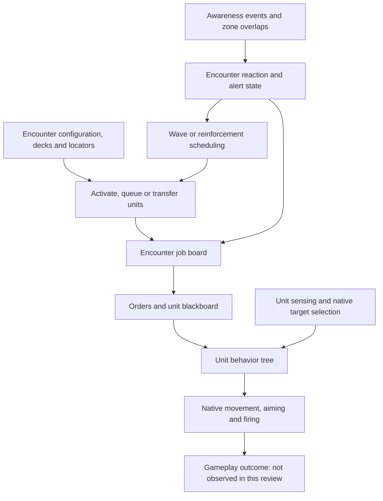

# MW5 AI: other units and encounter orchestration

**Review status: source analysis complete for this assigned collection; gameplay validation NOT_PERFORMED.** This workstream accounts for 59 inventory entries: 48 behavior/logic reviews, 9 supporting-data reviews and 2 unavailable paths. All 57 available source exports and 26 associated class-default exports were reviewed. The machine-readable [coverage ledger](coverage/other-units.json) records every entry, citations and limitations.

The main finding is that MW5 has several distinct decision layers. Tank, VTOL and turret trees decide what an individual unit does next. Encounter components decide which units become active, which jobs they receive, what they know about the player and when more units arrive. A tactical companion should reason from friendly observations of those effects. It should not read hidden encounter decks or enemy awareness merely because those fields are technically discoverable.

## Scope and evidence rules

Evidence is the preserved `ai-research-collection-20260921T030437Z-f7d8e930` export from editor 1.1.390.0e, UE4.26.2 compatibleCL 14830424, reviewed across September 20–21, 2026. Relevant collection scope is IDs 018–028, 127–157 and 214–230. This is an allowlisted sample of accessible assets, not all MW5 AI. No game/editor execution or new collection occurred during this analysis.

**DOCUMENTED** below means directly supported by exported source or configuration. **PROPOSED** identifies an interpretation or experiment. **UNKNOWN/BLOCKED** identifies a dependency or runtime fact the exports cannot establish. **OBSERVED** gameplay evidence is absent. Native navigation, targeting, weapon execution and spawning bodies are not reconstructed from their function names.

Blueprint review followed registered function/event graphs and connected execution/data pins. Behavior-tree review followed `RootNode` and serialized `Children` links; graph position, node labels and a stored `ParentNode` alone were insufficient. EQS review separated scoring from filtering. Generated duplicate/expanded graphs were not counted as independent behavior. Class defaults were checked separately from tree-instance overrides. Coordinates below are **raw engine coordinates** unless a field explicitly names another unit; no player-facing distance or physical spawn guarantee is inferred by conversion.

## The layers that explain behavior

This is a conceptual dependency map, not a claim that every spawned actor traverses every box. Encounter parent construction adds a job board; posting wrappers construct jobs and requirements. Base encounter components bind awareness/lifecycle events and transfer units to boards. Tank/VTOL master trees prioritize mission orders before their autonomous combat branch. [229, L10922–12582](evidence/editor-source/ai-research-collection-20260921T030437Z-f7d8e930/229-EncounterClassParent-source.COPY) [229, L18688–18746](evidence/editor-source/ai-research-collection-20260921T030437Z-f7d8e930/229-EncounterClassParent-source.COPY) [226, L4182–5126](evidence/editor-source/ai-research-collection-20260921T030437Z-f7d8e930/226-EncounterBehaviorComponent-source.COPY) [132, L408–449](evidence/editor-source/ai-research-collection-20260921T030437Z-f7d8e930/132-BT_TankMasterTree-source.COPY) [148, L341–383](evidence/editor-source/ai-research-collection-20260921T030437Z-f7d8e930/148-BT_VTOLMasterTree-source.COPY)

## Workers and fleeing infantry

The collected infantry branch concerns workers and pilots. `InfantryAIController.Start` runs `BT_GarrisonWorker`; `Flee` runs `BT_Flee`; arrival calls the pawn's `ReachedTarget`. The default controller has no automatic default behavior tree and does not start AI logic on possession, so an external caller is material. Its BeginPlay/Tick nodes are unconnected. These exports do **not** establish a complete armed-infantry combat model. [28, L36–173](evidence/editor-source/ai-research-collection-20260921T030437Z-f7d8e930/028-InfantryAIController-source.COPY) [28 defaults, L59–78](evidence/editor-source/ai-research-collection-20260921T030437Z-f7d8e930/028-InfantryAIController-defaults.COPY)

In the worker tree, a non-burning worker needs `DestinationExists`. It copies the pilot's `DestinationLocation` to `MoveLocation`, moves with an acceptable radius 300 using `GroundAI_Filter`, and notifies arrival. The burning branch chooses a navigable point within 400 of the controlled pawn and moves there. Both the destination and burning checks depend on infantry-specific casts. [18, L25–89](evidence/editor-source/ai-research-collection-20260921T030437Z-f7d8e930/018-BTDecorator_CheckForTarget_-source.COPY) [22, L30–123](evidence/editor-source/ai-research-collection-20260921T030437Z-f7d8e930/022-BTTask_WorkerFindTarget_-source.COPY) [24, L182–264](evidence/editor-source/ai-research-collection-20260921T030437Z-f7d8e930/024-BT_GarrisonWorker-source.COPY) [25, L25–88](evidence/editor-source/ai-research-collection-20260921T030437Z-f7d8e930/025-BTDecorator_CheckBurning-source.COPY) [26, L30–129](evidence/editor-source/ai-research-collection-20260921T030437Z-f7d8e930/026-BTTask_OnFire-source.COPY)

The flee tree's non-burning path waits 2 seconds with 0.5 deviation, chooses an escape vector, moves within 500 and sets `IsCowering=true`. Its query center is calculated from player-character index 0 toward **OwnerActor**, offset by 7500 horizontally, followed by a random navigable-point query of radius 2000. OwnerActor is not replaced with an explicit controlled-pawn location on that path. The nav query's success result is unused, so this is an intended escape calculation, not proof of a valid escape route. A burning worker instead takes the burning-movement branch. [20, L38–183](evidence/editor-source/ai-research-collection-20260921T030437Z-f7d8e930/020-BTTask_FindFleeLocation-source.COPY) [19, L26–102](evidence/editor-source/ai-research-collection-20260921T030437Z-f7d8e930/019-BTTask_Cower-source.COPY) [23, L184–268](evidence/editor-source/ai-research-collection-20260921T030437Z-f7d8e930/023-BT_Flee-source.COPY)

Most small worker tasks finish successfully only after their expected cast chain; failed casts have no connected `FinishExecute`. `BTTask_ReachTarget` specifically requires `InfantryAIController`. Its later reuse by vehicle hold trees is therefore a precise validation lead, rather than evidence that vehicles share infantry movement logic. [21, L24–84](evidence/editor-source/ai-research-collection-20260921T030437Z-f7d8e930/021-BTTask_ReachTarget-source.COPY)

**Worked source example:** a worker with a destination and `OnFire=false` can take the ordinary destination path. If `OnFire` changes, the tree's aborting decorators make the burning branch eligible. This predicts a change of movement intent; it does not predict a successful route, animation transition or survival time, because those implementations and gameplay observations are absent. [24, L182–264](evidence/editor-source/ai-research-collection-20260921T030437Z-f7d8e930/024-BT_GarrisonWorker-source.COPY)

## Tanks

The tank master tree's active priorities are: flee location; mission orders; autonomous aggressive combat if `CanAttack`; investigation of a suspicion actor; waypoint travel; then return home and ambient behavior when a player is nearby. A not-Idle gate and update-senses service sit above these choices. The native combat-target service is configured for auto-attack at an interval 1 with 0.25 deviation; this is a requested update cadence, not a latency measurement. [132, L408–449](evidence/editor-source/ai-research-collection-20260921T030437Z-f7d8e930/132-BT_TankMasterTree-source.COPY) [132, L521–638](evidence/editor-source/ai-research-collection-20260921T030437Z-f7d8e930/132-BT_TankMasterTree-source.COPY)

The aggressive tree first sets combat interaction. With a target, it queries a combat-circle destination and chooses long-range or ordinary movement. Long-range means the tank controller reports `OnlyHasLRMs`, **or**, otherwise, its tank pawn has `bFightFromLongRange`. This is not an AND requirement. Failed controller/pawn casts make that decorator false. The long-range move has a `TankLRMBruteForce` query service at interval 1; ordinary movement performs its combat-circle query then moves and waits 0.1. Without a combat target it waits 1. [127, L35–143](evidence/editor-source/ai-research-collection-20260921T030437Z-f7d8e930/127-BTDecorator_TankShouldFightAtLongRange-source.COPY) [129, L296–466](evidence/editor-source/ai-research-collection-20260921T030437Z-f7d8e930/129-BT_Tank_Aggressive-source.COPY)

`BT_TankFollow` prioritizes fighting when a target exists. Its noncombat path treats a formation actor differently from free TravelLocation movement, with checks for formation movement, distance and final-destination state. This helps explain why following is not equivalent to continuously holding a fixed relative point. Whether a given tank actually receives this tree still needs assignment evidence. [130, L396–595](evidence/editor-source/ai-research-collection-20260921T030437Z-f7d8e930/130-BT_TankFollow-source.COPY)

Two stored-graph traps matter:

- `BT_TankTeamOrders` has **only Stop→hold and a wait fallback connected to its runtime root**. Follow, Attack and Move node groups are stored but disconnected. The export cannot be summarized as supporting all of them merely because the nodes exist. [133, L345–417](evidence/editor-source/ai-research-collection-20260921T030437Z-f7d8e930/133-BT_TankTeamOrders-source.COPY) [133, L438–476](evidence/editor-source/ai-research-collection-20260921T030437Z-f7d8e930/133-BT_TankTeamOrders-source.COPY)
- `BT_Tank_Aggressive` contains an extra movement node with its own combat-circle EQS service that is disconnected from the active root. It does not establish an additional live position-update path. [129, L296–409](evidence/editor-source/ai-research-collection-20260921T030437Z-f7d8e930/129-BT_Tank_Aggressive-source.COPY)

The hold-position tree also references the infantry-specific `BTTask_ReachTarget`. The smallest useful follow-up is to identify the actual tree assigned to one disposable tank, record the executed task when Stop is active, and observe completion. Until then these are **source anomalies requiring validation**, not statements that shipping tank commands are broken. [131, L200–279](evidence/editor-source/ai-research-collection-20260921T030437Z-f7d8e930/131-BT_TankHoldPosition-source.COPY) [21, L24–84](evidence/editor-source/ai-research-collection-20260921T030437Z-f7d8e930/021-BTTask_ReachTarget-source.COPY)

The separate MoveToAndFire and Patrol trees are simpler scripted variants: follow waypoints, mark destination state and, for MoveToAndFire, call the task that explicitly targets player pawn index 0. That special-purpose task must not be used as evidence that all enemy target selection ignores lancemates. [136, L163–235](evidence/editor-source/ai-research-collection-20260921T030437Z-f7d8e930/136-BT_TankMoveToAndFire-source.COPY) [137, L140–214](evidence/editor-source/ai-research-collection-20260921T030437Z-f7d8e930/137-BT_TankPatrol-source.COPY) [128, L40–183](evidence/editor-source/ai-research-collection-20260921T030437Z-f7d8e930/128-BTTask_FireAtPlayer-source.COPY)

## VTOLs and drones

VTOL master priorities resemble the tank hierarchy: flee, orders, combat, suspicion, waypoint and home/ambient. Its **runtime** order-tree reference points to `/Game/AI/VTOL/Behaviors/BT_VTOLTeamOrders`. The collection's stale Tank-folder metadata paths remain unavailable as IDs 134/135; the actual VTOL-folder exports 147/149 are separate reviewed entries. No exact redirect mechanism is asserted. [148, L341–383](evidence/editor-source/ai-research-collection-20260921T030437Z-f7d8e930/148-BT_VTOLMasterTree-source.COPY) [148, L488–539](evidence/editor-source/ai-research-collection-20260921T030437Z-f7d8e930/148-BT_VTOLMasterTree-source.COPY)

Aggressive VTOL combat selects from the best quarter of `EQS_VTOLCircle` results, moves with 1000 acceptable radius and refreshes the query on its movement service at interval 10. The query uses six points on a25000-radius, 60-degree arc around the combat target, oriented by that target's view direction; a native provider supplies optimal elevation instead of the serialized default 8000. Distance from other VTOLs, a 2D distance term, visibility trace and tether shape appear as **score-only tests**. The 2D term omits its `DistanceTo` context, so its precise reference point needs native-default confirmation. A visibility score is not a mandatory visibility filter, and omitted scoring defaults cannot be invented. [142, L178–258](evidence/editor-source/ai-research-collection-20260921T030437Z-f7d8e930/142-BT_VTOL_Aggressive-source.COPY) [143, L102–161](evidence/editor-source/ai-research-collection-20260921T030437Z-f7d8e930/143-EQS_VTOLCircle-source.COPY)

The follow tree first fights an existing target, otherwise follows a formation actor with 10000 acceptance and 5000 observed-location tolerance. The VTOL order tree's runtime root connects Stop, Follow and a wait fallback; its stored Attack/Move groups are disconnected. Its hold tree again refers to the human ReachTarget task. These details must be verified against actual actor/tree assignment before inferring in-game failures. [146, L85–123](evidence/editor-source/ai-research-collection-20260921T030437Z-f7d8e930/146-BT_VTOLFollow-source.COPY) [149, L334–459](evidence/editor-source/ai-research-collection-20260921T030437Z-f7d8e930/149-BT_VTOLTeamOrders-source.COPY) [147, L200–279](evidence/editor-source/ai-research-collection-20260921T030437Z-f7d8e930/147-BT_VTOLHoldPosition-source.COPY)

Ambient VTOL and drone behavior repeatedly reset/select ambient positions, move and wait. VTOL ambient uses a5000-radius candidate circle; drone ambient uses 500. Their distance tests are score-only: a serialized `FloatValueMin=50` does not make these hard minimum-distance constraints. Movement force-success decorators govern behavior-tree continuation; they do not certify that travel succeeded. [144, L178–263](evidence/editor-source/ai-research-collection-20260921T030437Z-f7d8e930/144-BT_VTOLAmbient-source.COPY) [145, L60–82](evidence/editor-source/ai-research-collection-20260921T030437Z-f7d8e930/145-EQS_VTOLFindAmbientLocation-source.COPY) [154, L178–263](evidence/editor-source/ai-research-collection-20260921T030437Z-f7d8e930/154-BT_DroneTarget-source.COPY) [156, L60–83](evidence/editor-source/ai-research-collection-20260921T030437Z-f7d8e930/156-EQS_DroneFindAmbientLocation-source.COPY)

Tutorial VTOL behavior is a separate scripted flight loop. `FlyToAndFire` walks a spawner's ordinary waypoint array, marks final arrival, and then the tree combines movement with fire interaction. `FireAndStrafe` cycles its combat waypoint array once the VTOL is within 2750 in XY. The service's name overstates its direct role: it updates destination and waypoint state; the separate task invokes FireAt. Target selection randomly samples the tutorial spawner's supplied target list, without a hostility/visibility check on that visible path. Invalid selections/casts do not have explicit connected finish paths. [150, L300–858](evidence/editor-source/ai-research-collection-20260921T030437Z-f7d8e930/150-BTService_FireAndStrafe-source.COPY) [151, L308–885](evidence/editor-source/ai-research-collection-20260921T030437Z-f7d8e930/151-BTService_FlyToAndFire-source.COPY) [152, L140–364](evidence/editor-source/ai-research-collection-20260921T030437Z-f7d8e930/152-BTTask_FindRandomTarget-source.COPY) [153, L70–230](evidence/editor-source/ai-research-collection-20260921T030437Z-f7d8e930/153-BTTask_FireAtRandomTargets-source.COPY) [155, L181–266](evidence/editor-source/ai-research-collection-20260921T030437Z-f7d8e930/155-BT_FlyToAndFire-source.COPY)

The tutorial tree overrides its FlyToAndFire service to 0.03 seconds, compared with its class default 0.5 plus 0.1 deviation. This is an important example of why defaults alone cannot describe runtime configuration. It is still not evidence that a shipping controller can sustain a33 Hz external control loop. [151 defaults, L1–23](evidence/editor-source/ai-research-collection-20260921T030437Z-f7d8e930/151-BTService_FlyToAndFire-defaults.COPY) [155, L181–266](evidence/editor-source/ai-research-collection-20260921T030437Z-f7d8e930/155-BT_FlyToAndFire-source.COPY)

## Turrets

The turret master tree sets a raw target-selection enum value 2, updates senses, and when not Idle selects combat interaction if it can attack, suspicion-focused rotation otherwise, then look-around when the player is nearby. Its native target picker also has auto-attack enabled at 1 plus 0.25 deviation. The export does not establish the human meaning of raw strategy 2, so it is deliberately not named “closest,” “weakest” or another invented policy. [140, L247–333](evidence/editor-source/ai-research-collection-20260921T030437Z-f7d8e930/140-BT_TurretMasterTree-source.COPY)

The rotate task reads the suspicion actor. If it is a controller, it focuses that controller's pawn; otherwise it focuses the actor itself. The tree gates this task using a suspicion-location key, whereas the task consumes a suspicion-actor key. Their consistent population depends on other code/runtime state. The turret blackboard inherits the shared unit blackboard without adding keys. [139, L32–138](evidence/editor-source/ai-research-collection-20260921T030437Z-f7d8e930/139-BTTask_Turret_RotateTowardsTarget-source.COPY) [141, L1–3](evidence/editor-source/ai-research-collection-20260921T030437Z-f7d8e930/141-Blackboard_Turret-source.COPY)

## Encounters: activation, awareness, jobs and pressure

### Unit accounting and posting

`EncounterClassParent` keeps GUID-indexed records containing activation flags, usage tags, unit type and an `IsDead` flag. The flags distinguish spawned, garage and reinforcement-drop states; “spawned” explicitly does not imply a job. Setup imports unit decks and locators, subscribes to spawn/left-play events, and creates bookkeeping records. This data is not a complete combat snapshot. [228, L1–12](evidence/editor-source/ai-research-collection-20260921T030437Z-f7d8e930/228-UnitActivationType-source.COPY) [230, L1–13](evidence/editor-source/ai-research-collection-20260921T030437Z-f7d8e930/230-EncounterUnitData-source.COPY) [229, L15404–16300](evidence/editor-source/ai-research-collection-20260921T030437Z-f7d8e930/229-EncounterClassParent-source.COPY)

Posting wrappers construct attack, patrol or guard jobs, apply alive and manned-suitability requirements, and post to the board or to a specified GUID list. They carry native policy inputs such as priority and keep-running. A call to a posting function is not proof of native selection, order acceptance or execution. The separate assignment/order traces are needed to connect this workstream to the final action path. [229, L10922–12582](evidence/editor-source/ai-research-collection-20260921T030437Z-f7d8e930/229-EncounterClassParent-source.COPY)

The visible `SpawnUnit` entry routes valid spawn-point/spawner cases through `AddUnitToSpawnQueue`; older direct-spawn branches remain stored but disconnected. Spawn callbacks mark matching records spawned, attach the configured sensors and a pilot component for queued units, and remove the GUID from the queue. LeftPlay marks the record dead and removes queued GUIDs. **LeftPlay is an event name, not proof of combat death**; cause must be recorded separately. [229, L16448–17457](evidence/editor-source/ai-research-collection-20260921T030437Z-f7d8e930/229-EncounterClassParent-source.COPY) [229, L18042–18687](evidence/editor-source/ai-research-collection-20260921T030437Z-f7d8e930/229-EncounterClassParent-source.COPY)

Spawn setup and editor utilities must be kept distinct. Autofill inventories building/spawner/route data and computes capacity. Its garrison-health calculation uses destructible-component bounds as a proxy, not mech armor. `AdjustAirWayPoints` traces vertically and applies an input altitude multiplied by 100 above the hit position. None of these helpers establishes frame-by-frame tactical path planning. [229, L3381–3670](evidence/editor-source/ai-research-collection-20260921T030437Z-f7d8e930/229-EncounterClassParent-source.COPY) [229, L3903–5835](evidence/editor-source/ai-research-collection-20260921T030437Z-f7d8e930/229-EncounterClassParent-source.COPY)

### Alert state and shared knowledge

The base encounter component dispatches friendly/hostile zone events using attitude checks, considers GUID membership when handling spawned units, binds awareness delegates, and moves units between encounter job boards. Its default tick capability is false; this graph is predominantly event-driven. Base extension points often return false or do nothing, while derived components supply behavior. A false result cannot always be equated to no side effects: `ActivateUnitsForJobs` posts but returns its false `HasActivated` result. [226, L1869–1981](evidence/editor-source/ai-research-collection-20260921T030437Z-f7d8e930/226-EncounterBehaviorComponent-source.COPY) [226, L3462–5126](evidence/editor-source/ai-research-collection-20260921T030437Z-f7d8e930/226-EncounterBehaviorComponent-source.COPY) [226, L5772–6980](evidence/editor-source/ai-research-collection-20260921T030437Z-f7d8e930/226-EncounterBehaviorComponent-source.COPY) [226 defaults, L1–22](evidence/editor-source/ai-research-collection-20260921T030437Z-f7d8e930/226-EncounterBehaviorComponent-defaults.COPY)

REDCON is especially easy to invert in a report. **Increase REDCON subtracts the input; Decrease adds it**, passing Min=1 and Max=MinimumREDCON to Clamp. The base default MinimumREDCON is 0, so a valid interval depends on initialization; this call alone does not prove initialized alert state. Standard garrison Start separately sets its minimum/current value to 4. Hostile identification, overlaps and sufficient sensor strength then reduce that number through the increase method. Thus lower numeric values correspond to the visible escalation direction in that initialized garrison path. Debug text or method names alone would give the wrong account. [226, L2508–2646](evidence/editor-source/ai-research-collection-20260921T030437Z-f7d8e930/226-EncounterBehaviorComponent-source.COPY) [226, L3262–3411](evidence/editor-source/ai-research-collection-20260921T030437Z-f7d8e930/226-EncounterBehaviorComponent-source.COPY) [226 defaults, L1–10](evidence/editor-source/ai-research-collection-20260921T030437Z-f7d8e930/226-EncounterBehaviorComponent-defaults.COPY) [219, L2708–2926](evidence/editor-source/ai-research-collection-20260921T030437Z-f7d8e930/219-StandardGarrisonBehaviorComponent-source.COPY) [219, L5685–5899](evidence/editor-source/ai-research-collection-20260921T030437Z-f7d8e930/219-StandardGarrisonBehaviorComponent-source.COPY)

A standard garrison tracks identified units, responds to target forgetting by checking other encounter-unit awareness components, activates its configured spawns and posts patrol/guard jobs. Commander choice uses faction and friendly/neutral/hostile attitude, and dialogue is conditional. A radar-sweep helper is gated to an 8-second sweep with 30-second reset timer. This explains shared event orchestration and faction-specific presentation; it does not prove distinct ally/enemy navigation or weapon-control algorithms. [219, L4670–5684](evidence/editor-source/ai-research-collection-20260921T030437Z-f7d8e930/219-StandardGarrisonBehaviorComponent-source.COPY) [219, L5900–6412](evidence/editor-source/ai-research-collection-20260921T030437Z-f7d8e930/219-StandardGarrisonBehaviorComponent-source.COPY) [219, L6413–7276](evidence/editor-source/ai-research-collection-20260921T030437Z-f7d8e930/219-StandardGarrisonBehaviorComponent-source.COPY)

`StandardBlankGarrisonBehaviorComponent` deserves separate treatment: its visible hostile-overlap path runs through a debug-enabled condition whose false execution pin is unconnected. Standard garrison's comparable path has a bypass. Do not turn this into a general claim of broken garrisons; first establish which concrete component is assigned and its debug state. [218, L191–522](evidence/editor-source/ai-research-collection-20260921T030437Z-f7d8e930/218-StandardBlankGarrisonBehaviorComponent-source.COPY) [219, L4670–5421](evidence/editor-source/ai-research-collection-20260921T030437Z-f7d8e930/219-StandardGarrisonBehaviorComponent-source.COPY)

### Ambushes and reinforcements

The ambush's initial trigger is more specific than simple proximity. It requires an unpaused, untriggered overlap by a player-squad unit, a nonempty deck, speed above 100 and a movement-direction dot product above 0.6 toward the encounter locator. It partitions VTOLs, vehicles and mech entries across ground and reinforcement paths. One ground spawner call supplies distance bounds 60000–110000; that is one call's configuration, not a universal safe spawn radius or guarantee that all enemies enter beyond a certain distance. [215, L1053–2528](evidence/editor-source/ai-research-collection-20260921T030437Z-f7d8e930/215-AmbushBehaviorComponent-source.COPY)

On spawned ambush units, the component explicitly adds player-squad actors to awareness and sets `Attack` plus a large `IdleDistanceFromPlayerMetres` value when its target/blackboard path is valid. This means mission scripting can contribute knowledge independently of a simple sight cone. It does **not** authorize a companion to exploit enemy awareness or future spawn decks. Friendly telemetry must distinguish visible, shared, stale and unknown observations. [215, L2686–2909](evidence/editor-source/ai-research-collection-20260921T030437Z-f7d8e930/215-AmbushBehaviorComponent-source.COPY)

Reinforcement dispatch listens for arrival, transfers the unit to the first configured target encounter and assigns that board. Alert dispatch builds a critical alert job and transfers units, then marks dispatch successful when a qualifying unit overlaps the destination zone. Its post uses `UseSpecificUnits=false` even though a list is supplied: the list alone is not a native assignment restriction. Defaults are baseREDCON 2 and increase 1. [216, L293–623](evidence/editor-source/ai-research-collection-20260921T030437Z-f7d8e930/216-DispatchReinforcementsBehaviorComponent-source.COPY) [217, L521–1438](evidence/editor-source/ai-research-collection-20260921T030437Z-f7d8e930/217-DispatchUnitsToAlertBehaviorComponent-source.COPY) [217 defaults, L1–11](evidence/editor-source/ai-research-collection-20260921T030437Z-f7d8e930/217-DispatchUnitsToAlertBehaviorComponent-defaults.COPY)

Dispatch activation also supports temporary wave locators and hotdrop locators. Ground units are queued in a configured grid, VTOLs use a surrounding-location helper, and unused GUIDs fall through to base activation. The default 16 spots is grid bookkeeping; no general collision-free capacity, universal spawn exclusion or transport guarantee follows. Underlying shared spawn-helper implementation is an unresolved dependency. [227, L1489–3739](evidence/editor-source/ai-research-collection-20260921T030437Z-f7d8e930/227-EncounterDispatchBehaviorComponent-source.COPY)

### Waves

Three explicit wave purposes are available: attack destructibles, attack the player lance, or travel to new home locations. The component selects wave-specific additional-data unit lists, excludes GUIDs already recorded as left play, activates and transfers them, then either posts critical jobs or assigns home-location vectors. These differences are encounter objectives, not separate low-level pilots. [221, L1–4](evidence/editor-source/ai-research-collection-20260921T030437Z-f7d8e930/221-DispatchWaveType-source.COPY) [222, L1440–2441](evidence/editor-source/ai-research-collection-20260921T030437Z-f7d8e930/222-DispatchWavesBehaviorComponent-source.COPY)

Next-wave scheduling supports a positive configured delay, a0.01 fallback timer, or strings requesting a wait for the previous wave to disappear. In the latter case, it removes current-wave GUIDs when OnUnitLeftPlay fires and schedules the next wave when none remain. It does not prove every removed actor was destroyed by the player. A worked example is a wave 1 configured to wait for previous-wave death: no amount of elapsed time alone releases wave 2 while tracked wave 1 GUIDs remain; release follows the event-driven count reaching zero. [222, L2442–2831](evidence/editor-source/ai-research-collection-20260921T030437Z-f7d8e930/222-DispatchWavesBehaviorComponent-source.COPY) [222, L3300–3549](evidence/editor-source/ai-research-collection-20260921T030437Z-f7d8e930/222-DispatchWavesBehaviorComponent-source.COPY)

Home locations come from a circle query centered on a randomly selected configured dispatch locator. The query generates 20 points at radius 11000, projects them onto navigation and has no serialized scoring/filter tests. It therefore does not demonstrate a cover/danger optimizer. `ArcAngle=60` appears without an enabled arc flag, so it is not reported as a confirmed 60-degree arc. Query completion can mark `QueryRun=true` and flush queued unit assignments even after failure, making an empty-result scenario a useful narrow experiment. [220, L139–325](evidence/editor-source/ai-research-collection-20260921T030437Z-f7d8e930/220-Context_WaveLocation-source.COPY) [223, L71–89](evidence/editor-source/ai-research-collection-20260921T030437Z-f7d8e930/223-EQS_WaveHomeLocationCircle-source.COPY) [222, L2904–3299](evidence/editor-source/ai-research-collection-20260921T030437Z-f7d8e930/222-DispatchWavesBehaviorComponent-source.COPY)

## Shared versus faction-specific AI

**DOCUMENTED:** tank, VTOL and turret trees reuse shared unit blackboards, senses, combat-target interfaces and native task families, with different exposed priorities and query configurations. Encounters apply attitude, faction, job targets and scripted knowledge. Worker infantry are a separate controller/pawn path. Tutorial assets explicitly know a spawner, waypoint array and target list. [138, L1–8](evidence/editor-source/ai-research-collection-20260921T030437Z-f7d8e930/138-Blackboard_Tank-source.COPY) [141, L1–3](evidence/editor-source/ai-research-collection-20260921T030437Z-f7d8e930/141-Blackboard_Turret-source.COPY) [157, L1–23](evidence/editor-source/ai-research-collection-20260921T030437Z-f7d8e930/157-Blackboard_VTOL-source.COPY) [132, L408–449](evidence/editor-source/ai-research-collection-20260921T030437Z-f7d8e930/132-BT_TankMasterTree-source.COPY) [148, L341–383](evidence/editor-source/ai-research-collection-20260921T030437Z-f7d8e930/148-BT_VTOLMasterTree-source.COPY) [140, L247–333](evidence/editor-source/ai-research-collection-20260921T030437Z-f7d8e930/140-BT_TurretMasterTree-source.COPY) [28, L36–173](evidence/editor-source/ai-research-collection-20260921T030437Z-f7d8e930/028-InfantryAIController-source.COPY) [152, L140–364](evidence/editor-source/ai-research-collection-20260921T030437Z-f7d8e930/152-BTTask_FindRandomTarget-source.COPY)

**UNKNOWN/BLOCKED:** these exports do not enumerate every real enemy/allied unit's controller, tree, config override, team relationship or DLC variant at spawn. A shared asset does not prove identical difficulty, accuracy, perception or tactical behavior. Conversely, enemy-specific encounter objectives do not imply different underlying locomotion. Actual assignment and observer samples are required before claiming parity or improvement.

## Technical review leads and smallest experiments

These are proposed future tests, **all NOT_PERFORMED**. They need an approved disposable scenario, exact artifact manifest and rollback before any game-affecting implementation.

| Lead | Evidence and importance | Smallest resolving experiment |
|---|---|---|
| Vehicle order branches stored but disconnected | Tank root connects Stop only; VTOL root connects Stop/Follow. Names are insufficient to infer active command support. | Log actual actor→controller→tree assignment and one task transition for a single order; retain an unaffected sentinel unit. |
| Infantry ReachTarget in vehicle hold trees | Task requires InfantryAIController. Potential incompatible task, contingent on assignment. | Observe one assigned vehicle hold task's class, cast outcome, completion and native movement. |
| Type filtering selects HasTag=false | Encounter `GetAllUnits` adds to its type list on the false branch, then intersects filters. It cannot be assumed to be an inclusion filter. [229, L8030–8948](evidence/editor-source/ai-research-collection-20260921T030437Z-f7d8e930/229-EncounterClassParent-source.COPY) | On a tiny disposable encounter with one known type of each, compare exact input tags and returned GUIDs with IgnoreUnitTypeTag on/off. |
| Blank-garrison debug gate | False branch unconnected; assignment unknown. | Observe component class and debug gate in one known blank encounter, without changing combat policy. |
| Wave query failure/empty locations | Completion sets query-run and can drain queue after a failed query. | Controlled observer or editor test with zero candidates; record validity before any home-vector assignment. |
| Same encounter used as source/destination | One dispatch wave-locator transfer path supplies the created encounter on both pins; parent transfer adds then removes map data. [227, L1489–1840](evidence/editor-source/ai-research-collection-20260921T030437Z-f7d8e930/227-EncounterDispatchBehaviorComponent-source.COPY) [229, L9719–9854](evidence/editor-source/ai-research-collection-20260921T030437Z-f7d8e930/229-EncounterClassParent-source.COPY) | Trace the two encounter identities and GUID map before/after that one call on a disposable locator. |
| Scripted target knowledge | Ambush adds player squad directly to awareness. | Record when enemy knowledge appears relative to sensory events; companion still receives only legitimate friendly observations. |
| Spawn queue versus actor existence | Active source path queues units; callbacks perform later bookkeeping. | Match queue request→spawned GUID→actor identity→job assignment; do not treat a return value as the whole chain. |

The vehicle native controller implementation, native `PickCombatTarget`, `MWMoveTo`, EQS elevation/tether tests and the deferred shared function library have high importance for exact performance claims. Pilot/worker state machines and tutorial spawners are medium importance for their specific units. Unavailable Tank-folder VTOL metadata is lower importance for describing the reviewed resolved VTOL exports, but remains an explicit coverage gap. No broad recollection is justified by this review alone.

## Implications for the tactical prototype

**PROPOSED:** use observed threat identity/type and friendly weapon envelopes to coordinate targets, while leaving native per-frame aiming and movement intact. The source supports different vehicle/VTOL movement configurations; it does not quantify their live threat enough to hardcode universal “kill every tank first” rules.

**PROPOSED:** distinguish an enemy locally changing tactics from an encounter activating another group or advancing a wave. The offline prototype should preserve uncertainty about unseen reserves. It may reconsider after a newly observed wave appears, but should not predict its exact spawn from hidden mission data.

**PROPOSED:** require actor identity, authority, fresh friendly observations and separately validated actions before any live recommendation can become a command. Per-unit human orders must remain authoritative. None of the critical-priority enemy encounter jobs reviewed here grants a companion permission to override a human.

This analysis provides source-grounded context and experiments for the next passive observer. It does not establish a shipping-game transport, native command acceptance, real-time control rate or measured tactical improvement. Those remain explicit later milestones.
