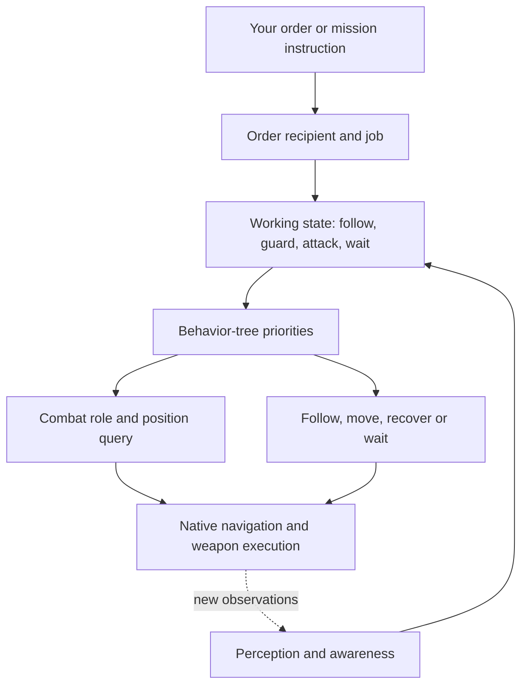

# How MW5's AI works, and how we can build better lancemates

Prepared 21 September 2026. **Static source research and an offline prototype; gameplay testing NOT_PERFORMED.** Applicable evidence: MW5 Editor 1.1.390.0e, Unreal 4.26.2, preserved collection `20260921T030437Z-f7d8e930`. This does not establish equivalence with the installed shipping game.

The available source supports a practical first step: add a commander that helps three lancemates choose useful targets and positions while the game's existing systems handle movement and shooting. The AI already has substantial combat behavior. The main opportunity is to coordinate that behavior around the mission, each mech's weapons, its condition and your orders. Whether our choices improve results must be measured in the game.

We have reviewed every available source export in the agreed collection: **249 inventory entries, 244 source exports and 128 class-default exports**. The [coverage ledger](AI_COVERAGE_LEDGER.md) records 167 semantic behavior/logic reviews, 77 supporting-data reviews and five unavailable entries. Every available export has an individual review record; all 372 artifact hashes match the preserved collection. Compiled engine/game internals, the five missing exports and 222 unresolved metadata references remain explicit limitations. This is a complete review of the collected accessible scope, not a reconstruction of every line of MW5's AI.

## What a lancemate is doing during a fight

A mech's behavior comes from several cooperating systems. A squad order can create a job. The job changes the mech's working state. A behavior tree repeatedly selects eligible work in priority order. Combat services choose a role and request targets or positions. Native systems perform much of the actual perception, pathfinding, steering and weapon control.

Think of a behavior tree as an ordered checklist: try the earlier eligible task, and move to the next when its conditions or result permit. Merely finding a task in an exported asset does not prove it participates in that checklist. Our reviews followed the runtime root and connected execution pins; several attractive-looking tasks were stored but disconnected.

The shared mech master tree prioritizes fleeing, mission orders, permitted combat, suspicion investigation, patrol and home/ambient behavior. The ally master has its own wait/guard/attack checks before default following. These are related paths, not one universal sequence that every actor is proven to execute. Actual controller/tree assignment matters. [Combat priorities](AI_COMBAT_ANALYSIS.md#how-a-mech-chooses-work); [ally orders](AI_MOVEMENT_ANALYSIS.md#orders-change-state-acknowledgements-do-not-prove-completion); [assignment trace](AI_ASSIGNMENT_TRACE.md).

## What it knows about the battlefield

The exposed senses service reacts to awareness changes and newly known targets. It can use a current combat target, or ask native awareness for the unit with greatest awareness, then update suspicion and last-known-location state. The native target-selection component's full scoring algorithm is unavailable. We cannot honestly say exactly why every target wins, or reconstruct that algorithm from a function name.

One especially useful finding: the decorator named `HasLineOfSight` calls a native visibility test with a **two-second threshold**. That is evidence of a visibility-history check, not proof that a shot has a clear path at this instant. Another apparent target-selection helper exists without a connected caller in the export. It must not be credited as the active algorithm. [Observation and target selection](AI_COMBAT_ANALYSIS.md#observation-and-target-selection).

Our companion must use only information available to the friendly lance. Reading enemy awareness or an encounter's upcoming spawn deck would give it knowledge you could not legitimately possess. The offline prototype therefore requires explicit friendly knowledge, current visibility, freshness and a clear firing opportunity. Those are proposed input assertions; we have not yet built an observer that can supply them.

## Why different mechs fight differently

The role picker tries a configured primary tactic when suitable. Its fallback considers weight and native weapon-range capability. It can choose Ranged, Indirect, Tank, Mobile or HitAndRun. Here **Tank is a mech combat role**, separate from a tank vehicle.

| Role | What the connected source requests | What remains uncertain |
|---|---|---|
| Ranged | Query useful positions around the target; attempt visibility recovery when needed. | Actual cover, path result and firing effectiveness. |
| Indirect | Use indirect-role position queries with range, spacing and other preferences. | A valid missile solution is not guaranteed by the role name. |
| Mobile | Use shared movement, with an evasive mode driven by a native dead-zone test. | The dead-zone calculation and resulting survival benefit. |
| Tank | Temporarily use Mobile behavior after recent damage, otherwise try its own combat positions. | Whether a particular loadout benefits from those choices. |
| HitAndRun | Rush from longer distance, consider melee, then use start/end rush positioning. | Successful execution, exposure and damage efficiency. |

The source also contains hysteresis: Mobile's evasive counter rises and falls before changing modes. This helps explain why behavior need not change instantly with one observation. Role selection, accuracy, heat willingness and pilot configuration are separate layers. A configuration value is not a measured probability unless the native consumer establishes that interpretation. Skill-growth curves are progression/configuration logic, not evidence of a pilot learning battlefield tactics from experience. [Role selection, position queries, weapons and pilot configuration](AI_COMBAT_ANALYSIS.md).

Position queries deserve care. Some tests reject unsuitable positions; others only change their score. A comment saying “filter out” can sit beside an actual score-only test. Thus “the AI ran this query” is weaker than “this destination has a valid path and clear fire.” Our prototype accepts only supplied candidates whose prerequisites have been established in its synthetic input.

## Following you does not switch combat off

The follow job chooses the player-squad leader during worker setup. Its trees can fight while following and can return toward formation when required. That is a promising basis for regrouping without rewriting shooting. It also means a future command adapter must verify who the native leader actually is; the order issuer cannot simply be assumed to be the follow target. [Follow analysis](AI_MOVEMENT_ANALYSIS.md); [order lifecycle](ORDER_LIFECYCLE_TRACE.md).

A move order is closer to guarding an area than pinning a mech to an exact spot. The ally move job projects a supplied destination onto navigation. Its subsequent tree can select positions near that destination. Projection alone does not prove a complete route. The arrival callback ignores its request ID and does not visibly finish the job; arrival dialogue is therefore inadequate as our completion signal. [Movement and completion](AI_MOVEMENT_ANALYSIS.md#orders-change-state-acknowledgements-do-not-prove-completion).

Two misleading names illustrate why source review matters. `IsClosingIn` tests whether velocity is sufficiently nonzero, not whether distance to the target is decreasing. `IsAllyNearby` has a connected result that can be true when no qualifying allies were found. These are source observations requiring context, not claims that every shipping encounter is broken. They should never become companion safety predicates without independent validation. [Navigation and recovery](AI_MOVEMENT_ANALYSIS.md#navigation-position-selection-and-recovery).

## Enemies, other allies and smaller units

The evidence supports substantial reuse: shared blackboards, awareness services, target-selection interfaces and native task families appear across unit types. Different trees, configuration, attitudes, objectives and encounters can still produce different behavior. We have not observed every enemy and ally's actual runtime assignment, so “all sides have identical AI” would overstate the result.

Tank vehicles have their own ordered behavior and long-range checks. VTOLs have flight-specific movement and formation behavior. Turrets select combat or suspicion-facing behavior. The collected infantry assets principally describe workers/pilots fleeing, cowering or reacting to fire; they do not expose a general armed-infantry combat system. Some tank/VTOL order branches are serialized but disconnected from their runtime roots. These are targeted investigation leads, not proof of broken shipping commands. [Other-unit analysis](AI_OTHER_UNITS_ANALYSIS.md).

Encounters operate above individual units. They organize activation, job boards, waves, spawning and shared knowledge. For example, a connected ambush path explicitly adds player-squad actors to enemy awareness. This can explain behavior that would not follow from a simple local visual scan. It does not justify giving our friendly companion access to hidden encounter state. Names can mislead here too: “Increase REDCON” subtracts from its numeric alert value, and a LeftPlay bookkeeping event is not proof that a unit died in combat. [Encounter orchestration](AI_OTHER_UNITS_ANALYSIS.md#encounters-activation-awareness-jobs-and-pressure).

## How the offline commander uses these findings

The implemented prototype is a deterministic JavaScript function. Given a squad snapshot and its previous decision state, it returns an individual recommendation for each of up to three lancemates, with a reason, evidence references and missing prerequisites. It reserves proposed positions across the squad and limits unnecessary target concentration when alternatives exist. It has no connection to the game.

Its vocabulary is deliberately small: **maintain, regroup, focus a known target, reposition to a supplied candidate, or defer**. These are project intentions, not newly discovered MW5 commands. Every result is marked `MOCK_ONLY` and `dispatchable: false`.

The [versioned tactical playbook](../design/TACTICAL_PLAYBOOK.md) links each decision to observations, evidence, assumptions, cancellation conditions and evaluation cases. Future work can load and revise it. This provides project continuity; it does not change model weights or confer permanent learning.

Human commands take precedence. An unresolved human order stays held. A persistent order requires explicit release; a nonpersistent order requires matching verified completion or release. Silence, missing observations, elapsed time, an order-menu close or a line of dialogue cannot release it. Unknown control authority, human possession or stale state produces deferral. The separate older command-contract exercise remains a simulation and is not used as evidence of native acceptance.

The prototype starts with **48 scenario cases and three general properties**, plus a separate adversarial review suite. Exact executed totals, hashes and verdicts are recorded in [the main results](OFFLINE_TACTICAL_RESULTS.json) and [independent review](TACTICAL_INDEPENDENT_REVIEW.md). Tests check deterministic behavior, human precedence, invalid state, hidden targets, mixed ranges, target allocation and shared-position conflicts. Passing them establishes the offline contract only.

## Four battle examples

These are **PROPOSED / MOCK_ONLY illustrations**, not recorded gameplay.

**A mixed-range lance meets two enemies.** Two healthy mechs have useful firing opportunities on the higher-threat known target. A third has another useful target in range. The coordinator can split its recommendations instead of always assigning all three to the first target. If the short-range mech has no useful current shot but a supplied clear, reachable firing position, it can recommend that position. It cannot invent terrain knowledge or promise native attack orders will produce these positions.

**One lancemate is badly damaged under fire.** Below the proposed critical-health threshold, the policy prefers an explicitly safer reachable position. If none is supplied, it can recommend a verified safe regroup route to the correct leader. If neither is known, it maintains native behavior and reports the missing prerequisite. Running toward the commander is not automatically safer.

**You order that damaged mech to hold.** The human order supersedes those autonomy recommendations immediately when a valid observation reports it. The companion continues to hold even if the mech disappears from an observation or the order is persistent. It resumes only after the required completion/release evidence. End-to-end response latency remains unknown until an observer and adapter exist.

**An enemy disappears behind a ridge.** Native AI may retain some visibility history. The prototype cannot treat that as a confirmed clear shot. It drops an unsupported focus recommendation and maintains or chooses another fully supported action. It never uses hidden enemy positions to fill the gap.

## What we should improve first, and how to judge it

| Hypothesis | Why it is plausible | Evidence needed before claiming improvement |
|---|---|---|
| Better range matching | Native roles consider weapons, but squad placement may still waste individual opportunities. | Compare useful firing time, damage and exposure on the same loadouts/scenarios. |
| Fewer unnecessary target changes | Retaining a useful target may reduce movement and interrupted opportunities. | Record target switches, time without useful fire and mission results. |
| Protect damaged units | A squad-level policy can weigh preservation against the mission objective. | Measure survival, repairs, mission success and damage dealt; verify escape safety. |
| Coordinate all three positions | Shared reservations can avoid deliberately selecting the same supplied location. | Observe actual endpoints, collisions and firing obstruction; reservations alone prove none of these. |
| Better recovery decisions | Multiple position samples can distinguish movement from progress. | Trace one reproducible obstruction, native recovery state and actual progress before modifying anything. |

Use paired, repeatable Instant Action scenarios with recorded versions, loadouts, difficulty and enabled mods. Include multiple repetitions and failures. A win in one mission, or more damage at the expense of survival, is not enough. No performance improvement has been measured yet.

## The route to autonomous lancemates

The next milestone is **passive observation**, not a commander issuing orders. We need correct actor identity, fresh state, possession changes and reliable human-command detection. The [integration handoff](../design/PASSIVE_OBSERVER_HANDOFF.md) identifies a candidate player-controller component path, its missing initialization caller, cooking/installation questions and the exact evidence an isolated observer test must gather.

After that: prove one Form On Me order to one designated AI with an unaffected sentinel; run recommendations against genuine observations; enable bounded decisions for one AI; then coordinate three and compare against vanilla. Each advancement needs observed behavior, correct recipients and human override, not merely a successful message or an accepted job.

Direct piloting is a later, separate engineering milestone. The source includes special scripted low-level movement examples, but these do not establish a general steering/aiming/firing interface or a reliable local control loop. Continuous observation, authority, timing, arbitration and native fallback must be proven capability by capability. This chat should not be treated as a frame-by-frame pilot.

The [technical appendix](AI_TECHNICAL_APPENDIX.md), [coverage ledger](AI_COVERAGE_LEDGER.json) and [final handoff](OVERNIGHT_HANDOFF.md) preserve the exact evidence, unresolved questions and next steps. No game/editor execution, retail modification, voice generation, paid API call, training or campaign persistence belongs to this package.
